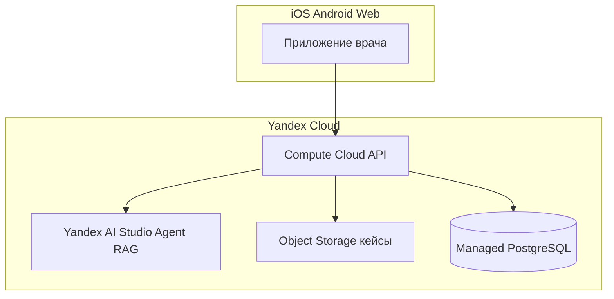

# SonoGyn Pro — заявка на грант Яндекс до 1 000 000 ₽

**Целевые программы (2026):**

| Программа | Ссылка | Фокус гранта |
|-----------|--------|----------------|
| **Yandex AI Studio Boost** | https://yandex.cloud/ru/blog/yandex-ai-studio-boost | До **1 млн ₽** на **Yandex AI Studio** — ИИ-агенты, RAG, модели |
| **Yandex Cloud Boost** (Migrate) | https://yandex.cloud/ru/cloud-boost | До **1 млн ₽** на **инфраструктуру** Yandex Cloud |
| **Yandex AI Startup Lab** | https://yandex.ru/aistartup/ | Команда + грант на Cloud (другой формат отбора) |

> **Важно:** участие обычно только от **юрлица (ООО / ИП)**. Продукт — **MVP и выше** (сайт/приложение уже работает).

**Продукт:** https://sonogyn-pro.ru · монорепо `ravshikjonik-arch/sonogyn-pro`  
**Заявитель:** ООО / ИП *[подставить реквизиты]* · **Якубов Р.В.**, врач-фаундер, эксперт УЗИ/АГ  

---

# Часть 1 — Текст для полей анкеты (копировать блоками)

## 1.1. Название проекта

**SonoGyn Pro** — клиническая платформа и мобильное приложение для врачей УЗИ и акушеров-гинекологов: **профессиональный чат**, **ИИ-агент** с опорой на гайдлайны и **Evidence-поиск** (КР, PubMed), калькуляторы O-RADS, IOTA, BI-RADS, TI-RADS, акушерские модули.

## 1.2. Суть проблемы (до 500 слов)

В России десятки тысяч врачей УЗИ и АГ ежедневно описывают исследования, но протоколы (O-RADS, IOTA, FIGO, BI-RADS) и клинические рекомендации разрознены: PDF, мессенджеры, личные заметки. Это увеличивает время описания, утомляемость и риск **неструктурированного** заключения. Коллегиальная помощь уходит в закрытые Telegram-чаты без контроля этики и без связи с инструментами риска.

Ординаторы и начинающие специалисты не получают единой среды «кейс + калькулятор + источник». B2C-сервисы для пациентов не решают задачу **врача-профессионала**.

**SonoGyn Pro** нацелен на **B2P (business-to-professional)**: только врачи, CDS (clinical decision support), не замена диагноза.

## 1.3. Решение и инновация

Цифровой **рабочий кабинет**:

1. **ИИ-агент** по ролям (гинеколог / акушер / врач УЗИ) — ответ с **цитированием** источников (Evidence Assistant уже в production).
2. **Чат врачей** — профессиональное сообщество, разбор учебных кейсов (масштаб пилота **50 → 1000** пользователей).
3. **Калькуляторы** по международным и российским стандартам — единая кодовая база monorepo.

**Инновация для гранта:** перенос orchestration LLM и **агентского RAG** на **Yandex AI Studio** (Alice AI LLM / DeepSeek / Qwen + agent search по корпусу КР и методическим PDF проекта) при сохранении **on-premise логики** классификаций в `packages/medical-calculations` (не «чёрный ящик»).

## 1.4. Стадия продукта (MVP+)

| Критерий | Факт |
|----------|------|
| Работающий продукт | **https://sonogyn-pro.ru** (production) |
| Auth, кабинет, open access для набора аудитории | Да |
| Evidence Assistant API | Да, open-access + LLM fallback |
| Калькуляторы O-RADS, IOTA, BI-RADS, TI-RADS и др. | Да |
| Mobile | Expo (`apps/mobile`), релиз в roadmap |
| Безопасность | RLS Supabase, rate limit, Zod на API, аудит |

## 1.5. Целевая аудитория и рынок

- **Сегмент:** практикующие врачи УЗИ/АГ, ординаторы — **РФ и СНГ**.
- **TAM (ориентир):** ~30–50 тыс. врачей УЗИ/АГ в РФ; платёжеспособное ядро — частная практика и МО с УЗИ.
- **Пилот гранта:** **50 активных врачей** → **300** к концу периода → задел **1000+** (чат + push + mobile).

## 1.6. Монетизация (после гранта)

Подписка **PRO** (ЮKassa): расширенный ИИ, сохранение, приоритет; B2B — клиники (seat). Грант — на **технологическое** ускорение, не на операционную прибыль.

## 1.7. Социальный эффект

- Повышение **структурированности** УЗИ-описаний и доступа к **КР МЗ РФ** у врачей в регионах.
- Снижение фрагментации знаний; безопасный профессиональный чат вместо хаотичных мессенджеров.
- Обучение ординаторов на **деидентифицированных** кейсах.

## 1.8. Почему Яндекс

- **Yandex AI Studio:** агент с RAG по загруженным КР и авторским протоколам; **SpeechKit** — голосовой ввод в протокол (roadmap); масштабирование inference в РФ.
- **Yandex Cloud:** Compute + Managed PostgreSQL / Object Storage — **152-ФЗ-aware** архитектура (данные в РФ при миграции с текущего EU Supabase — этап гранта).
- Маркетплейс решений AI Studio — канал для B2B «медицинский copilot для клиник».

---

# Часть 2 — Презентация для загрузки (12 слайдов)

*Экспорт: каждый слайд → 1 страница PDF или Google Slides.*

---

## Слайд 1. Титул

**SonoGyn Pro**  
ИИ-агент и чат для врачей УЗИ / акушеров-гинекологов  

Заявка на грант **до 1 000 000 ₽** · развитие ИИ-агента и чата **50 → 1000** врачей  

Якубов Р.В. · врач-фаундер · https://sonogyn-pro.ru  

---

## Слайд 2. Проблема

- Протоколы O-RADS / IOTA / BI-RADS **не под рукой** в смене  
- Коллеги — в Telegram, **нет связи** с калькуляторами и КР  
- Нет единого **ИИ-помощника** с источниками для врача в РФ  

**Не для пациентов — для специалистов.**

---

## Слайд 3. Решение

**Один кабинет:** чат врачей + ИИ-агент + калькуляторы + Evidence  

```text
Клиническая ситуация → AI (с цитатами) → O-RADS / IOTA → учебный кейс
```

CDS: **решение принимает врач** (дисклеймер в продукте).

---

## Слайд 4. Продукт сегодня (MVP+)

| Модуль | Статус |
|--------|--------|
| Web-кабинет | Production |
| Evidence Assistant | API + UI |
| O-RADS, IOTA, BI-RADS, TI-RADS | Production |
| AI consultants | Production |
| Mobile iOS/Android | Expo, релиз в плане гранта |

---

## Слайд 5. Задачи гранта (6 месяцев)

1. **ИИ-агент v2** на **Yandex AI Studio** (RAG: КР МЗ, корпус проекта, PubMed pipeline).  
2. **Чат врачей** — realtime, модерация, пилот **50 → 300** MAU.  
3. **Mobile release** — паритет входа, push, чат + агент.  
4. **Миграция критичных сервисов** на **Yandex Cloud** (compute, object storage).  
5. Метрики, A/B качества ответов агента (врачебная экспертиза).

---

## Слайд 6. Интеграция с Yandex AI Studio

| Компонент | Использование |
|-----------|----------------|
| **Agent + RAG** | Ответы по КР и методичкам с цитатами |
| **Alice AI LLM / Qwen** | Русскоязычный синтез для врача |
| **Agent search** | Документы, протоколы, обновляемый корпус |
| **SpeechKit** (этап 2) | Голос → черновик протокола УЗИ |

Сохраняем **детерминированные** калькуляторы в коде (O-RADS/IOTA) — LLM не подменяет классификацию.

---

## Слайд 7. Архитектура (целевая)



---

## Слайд 8. Команда

| Роль | Кто |
|------|-----|
| Медицина, продукт, валидация | **Якубов Р.В.** — 15 лет АГ, 10 лет УЗИ |
| Разработка | AI-assisted engineering, monorepo, CI/E2E |
| Пилот | 2–3 врача → **50** в рамках гранта |

*[При необходимости: backend-разработчик part-time — см. бюджет]*

---

## Слайд 9. KPI гранта

| KPI | Старт | Через 6 мес |
|-----|-------|-------------|
| Активные врачи (MAU) | 10–20 | **≥ 300** |
| Сообщения в чате / нед | — | **≥ 500** |
| Запросы к ИИ-агенту / мес | — | **≥ 2000** |
| NPS пилота (опрос) | — | **≥ 40** |
| Mobile stores | — | **TestFlight + closed testing** |

---

## Слайд 10. Бюджет 1 000 000 ₽ (логика)

*Под **AI Studio Boost** — траты на сервисы Yandex AI Studio / Cloud по правилам программы.*

| Статья | ₽ | % |
|--------|---:|---:|
| **Yandex AI Studio** (inference, RAG, agent) | 400 000 | 40% |
| **Yandex Cloud** (Compute, Storage, сеть) | 250 000 | 25% |
| **Разработка** (mobile + чат + интеграция AI Studio) | 250 000 | 25% |
| **Пилот с врачами** (онбординг, UX-интервью, без оплаты пациентам) | 50 000 | 5% |
| **Юрид./комpliance** (152-ФЗ, политики) | 50 000 | 5% |
| **Итого** | **1 000 000** | 100% |

*Если программа **только Cloud Boost** — перераспределить: 25% Compute/VPC/Object Storage (лимит программы), остальное — SpeechKit, DataSphere, Managed DB и др. по [правилам Cloud Boost](https://yandex.cloud/ru/cloud-boost).*

---

## Слайд 11. Риски и митигация

| Риск | Митигация |
|------|-----------|
| Галлюцинации LLM | RAG + калькуляторы в коде; обязательные цитаты; режим без LLM |
| ПДн | Деидентификация кейсов; хранение в РФ; минимизация PHI в промптах |
| Низкий retention | Фокус чат + 50 лид-пользователей; PRO не в фокусе гранта |
| Vendor lock-in | Абстракция provider в `packages/evidence-retrieval` |

---

## Слайд 12. Итог и запрос

**Запрашиваем:** грант **1 000 000 ₽** на **6 месяцев**  

**Цель:** масштабируемый **ИИ-агент для врачей** на **Yandex AI Studio** + **чат 50→1000** + mobile  

**Готовность:** production https://sonogyn-pro.ru · команда · медицинская экспертиза  

**Контакт:** *[email, телефон, Telegram]* · support@sonogyn-pro.ru  

---

# Часть 3 — One-pager для комиссии (150 слов)

SonoGyn Pro — B2P-платформа для врачей УЗИ и акушеров-гинекологов (РФ). Уже в production: кабинет, Evidence с цитатами, калькуляторы O-RADS/IOTA/BI-RADS, AI-консультанты. Запрашиваем 1 млн ₽ на интеграцию **ИИ-агента** с **Yandex AI Studio** (RAG по КР и корпусу проекта), запуск **чата врачей** (пилот 50→300 MAU) и релиз **mobile**, с размещением backend на **Yandex Cloud**. Социальный эффект — доступ к структурированным протоколам и коллегиальной среде для врачей в регионах. Монетизация после гранта — подписка PRO. Продукт не заменяет врача; CDS с дисклеймером. Заявитель — врач-фаундер с 15-летним клиническим стажем.

---

# Часть 4 — Чеклист перед отправкой

- [ ] Юрлицо **ООО/ИП** создано, расчётный счёт  
- [ ] Указан **https://sonogyn-pro.ru** и скриншоты кабинета / Evidence / O-RADS  
- [ ] Презентация **PDF ≤ 10–15 MB** (12 слайдов выше)  
- [ ] Выбрана программа: **AI Studio Boost** *или* **Cloud Boost** — тексты согласованы (раздел 10)  
- [ ] В заявке явно: **интеграция с Yandex AI Studio / Yandex Cloud**  
- [ ] Нет формулировок «ИИ ставит диагноз» / «заменяет врача»  
- [ ] Контакт и реквизиты совпадают с юрлицом  

**Ссылки:**

- AI Studio Boost: https://yandex.cloud/ru/blog/yandex-ai-studio-boost  
- Cloud Boost: https://yandex.cloud/ru/cloud-boost  
- AI Startup Lab: https://yandex.ru/aistartup/  

---

*Документ подготовлен для SonoGyn Pro · 2026-10-21 · не является юридической или медицинской консультацией.*
