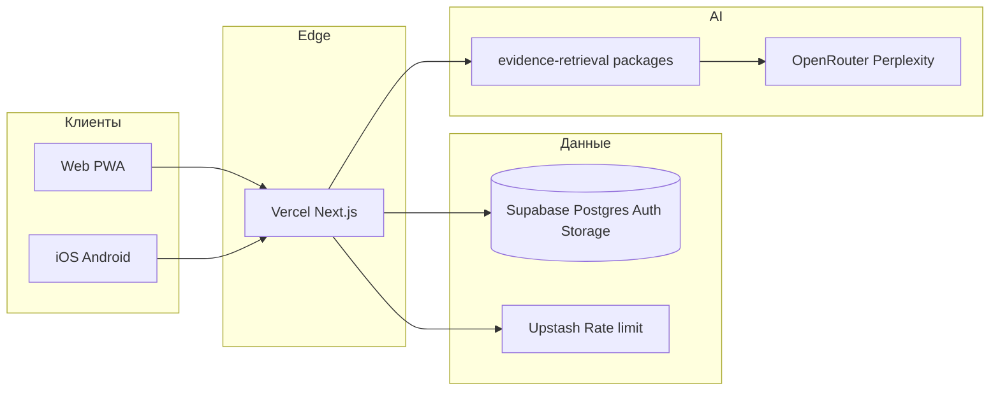

# SonoGyn Pro — презентация проекта (RU)

**Формат:** 18 слайдов · ~12–15 мин · аудитория: врачи, партнёры, инвесторы  
**Спикер:** Якубов Р.В., врач-фаундер  
**Production:** https://sonogyn-pro.ru  
**Дисклеймер на каждом выступлении:** учебный и справочный материал; решение принимает врач.

---

## Слайд 1 — Титул

**SonoGyn Pro**  
Клиническая платформа для врача УЗИ и акушера-гинеколога

- Чат врачей · AI-помощник · калькуляторы по гайдлайнам · Evidence · обучение
- Москва · Россия и СНГ · 2026

*Заметка спикеру:* «Мы делаем не “ещё один сайт”, а рабочий кабинет в кармане и на экране.»

---

## Слайд 2 — Проблема

**Врач в реальной смене:**

| Боль | Как проявляется |
|------|------------------|
| Протоколы «не под рукой» | O-RADS / IOTA / BI-RADS / FIGO — искать в PDF и чатах |
| Разрозненные инструменты | Калькулятор в одном месте, КР — в другом, коллеги — в Telegram |
| Усталость и риск ошибки | Нужна **структура** описания, а не «ещё один текст» |
| Обучение на ходу | Ординатору нужен безопасный разбор кейсов |

*Не для пациентов — только для специалистов.*

---

## Слайд 3 — Решение

**SonoGyn Pro = один вход → нужный инструмент**

```text
Врач открывает платформу
    → чат коллег + AI-помощник
    → сценарий (гинекология / акушерство / УЗИ)
    → калькулятор или Evidence по гайдлайну
    → (опционально) сохранение учебного кейса
```

**UX-принцип:** не «витрина из 50 ссылок», а **узкий маршрут под роль**.

---

## Слайд 4 — Для кого (3 персоны)

| Персона | Что получает |
|---------|----------------|
| **Врач-практик** | Приём, калькуляторы, протоколы, AI, PRO |
| **Ординатор / начинающий** | Обучение, quiz, атласы, career ladder |
| **Самопроверка** | Банки вопросов, прогресс, дисклеймеры |

**RBAC:** админ ≠ продуктовая персона; в продукте — роли врача.

---

## Слайд 5 — Две «сильные стороны» (ваш фокус)

### 1. AI-помощник (не «диагноз»)

- Консультанты по сценарию: гинекология, акушерство, УЗИ, **EBM / Evidence**
- Ответ с **источниками** (PubMed, КР, корпус гайдлайнов)
- Режим **CDS:** интерпретация — **специалист**

### 2. Чат врачей

- Профессиональное сообщество внутри платформы
- Кейсы, разбор изображений (с учётом этики и деидентификации)
- Масштаб: пилот **50 → 1000+** врачей (архитектура: realtime + backend)

---

## Слайд 6 — Клинические инструменты (единый источник истины)

**packages/medical-calculations · clinical-tools**

| Направление | Примеры |
|-------------|---------|
| Аднексальные образования | **O-RADS US**, **IOTA** (M/B-правила) |
| Молочная железа | **BI-RADS** US / MMG |
| Щитовидная | **TI-RADS** |
| Акушерство | биометрия, допpler, риски, **FMF/RU** |
| Гинекология | POP-Q, colposcopy, эндометрий, шейка матки |
| Отчёты | структурированный протокол УЗИ |

*Классификации — только по **FIGO, O-RADS, BI-RADS, TI-RADS, IOTA**, КР и приказам.*

---

## Слайд 7 — Evidence Assistant

**Вопрос врача → поиск → синтез с цитатами**

- Корпуса: **КР МЗ РФ**, PubMed, trials, гайдлайны
- Без LLM-ключей — **retrieval + rules** (не «пустой экран»)
- С Perplexity / OpenRouter — **синтез** с пометкой режима

**Фраза для слайда:**  
«Как UpToDate, но заточено под УЗИ/АГ и ваш рабочий язык.»

---

## Слайд 8 — Обучение и контент

- **LMS:** курсы, вебинары, библиотека
- **Quiz-banks**, self-assessment
- **Career ladder:** student → intern → doctor → pro
- **3D / атласы:** матка, яичник, fetal spine cards
- Авторские материалы фаундера (в т.ч. методички)

---

## Слайд 9 — Как выглядит продукт сегодня

| Канал | Статус |
|-------|--------|
| **Web** | https://sonogyn-pro.ru — кабинет, инструменты, Evidence |
| **Mobile** | Expo (iOS / Android) — паритет с web в roadmap |
| **Monorepo** | `apps/web` + `apps/mobile` + `packages/*` |

**Open access (набор аудитории):** вход в кабинет без обязательной регистрации; PRO / облачный профиль — по подписке.

---

## Слайд 10 — Архитектура (доверие IT-партнёру)



- **RLS** на новых таблицах · **Zod** на API · аудит безопасности
- ПДн: EU Supabase + политика 152-ФЗ (юридическое сопровождение при масштабе)

---

## Слайд 11 — Безопасность и compliance (коротко)

- Не «ИИ ставит диагноз» — **CDS + дисклеймер**
- Rate limit, bot protection на API
- PHI: guardrails, не логировать медданные в чат поддержки
- Платежи РФ: **ЮKassa** · международно: Stripe

---

## Слайд 12 — Бизнес-модель

| Уровень | Монетизация |
|---------|-------------|
| **Free / open cabinet** | Калькуляторы, базовый AI, набор аудитории |
| **PRO подписка** | Расширенный AI, сохранение, PRO-фичи, приоритет |
| **B2B (будущее)** | Клиники, белый label, корпоративные seat |

**Ориентир фаундера:** труд врача и экспертиза должны **оплачиваться**.

---

## Слайд 13 — Конкурентное отличие

| Другие | SonoGyn Pro |
|--------|-------------|
| Общий ChatGPT | **Сценарии УЗИ/АГ**, калькуляторы в том же потоке |
| PDF и таблицы | **Интерактив** + протокол |
| Разрозненные Telegram-чаты | **Чат врачей + кейсы** в одной среде |
| «Medical AI» без источников | **Evidence с цитатами** и КР |

---

## Слайд 14 — Дорожная карта

**0–3 мес**

- Стабильный mobile release
- Чат 50–100 врачей, обратная связь
- Evidence + O-RADS / IOTA в daily use

**3–12 мес**

- 1000+ врачей, PRO-конверсия
- FMF/RU пренатальный модуль (валидированные таблицы)
- Помощники: гинеколог · акушер · УЗИ — отдельные UX-потоки

**1–3 года**

- СНГ → международная локализация (EN, ES)
- B2B клиники

---

## Слайд 15 — Команда

**Якубов Равшан Вахобжонович (Р.В.)**

- 15 лет акушер-гинеколог · 10 лет врач УЗИ · Москва
- Врач-фаундер: медицина, сценарии, контент
- Разработка: AI-assisted engineering (Cursor), monorepo **sonogyn-pro**

**Пилот:** 2–3 врача (расширение до 50)

---

## Слайд 16 — Traction / факты

- Production: **sonogyn-pro.ru**
- Open-source monorepo: GitHub **ravshikjonik-arch/sonogyn-pro**
- E2E: auth, security, a11y, IOTA UI, Evidence smoke
- Ученики фаундера: **7** (клиническая линия обучения)

*Цифры регистраций / MRR — подставить актуальные перед investor-pitch.*

---

## Слайд 17 — Призыв к действию

**Для врача:**  
https://sonogyn-pro.ru → кабинет → O-RADS / IOTA / Evidence

**Для партнёра / клиники:**  
пилот 50 мест · обратная связь · совместный контент

**Контакт:** support@sonogyn-pro.ru · Telegram (канал фаундера)

---

## Слайд 18 — Юридический слайд (обязательный)

SonoGyn Pro — **clinical decision support** и обучение.

- Не заменяет очный осмотр и не является медицинским изделием в формулировке слайда без рег. удостоверения
- Заключение и тактика — **врач**
- При сомнениях — первоисточник и локальный протокол МО

---

# Приложение A — One-liner и elevator pitch (30 сек)

> **SonoGyn Pro** — это кабинет врача УЗИ и акушера-гинеколога: коллеги и AI в одном приложении, O-RADS, IOTA и Evidence по гайдлайнам — без поиска PDF в мессенджере. Учебный материал; решение принимает специалист.

---

# Приложение B — Как перенести в PowerPoint / Google Slides

1. Каждый блок `## Слайд N` = **1 слайд**
2. Заголовок = первая строка после `##`
3. Таблицы — вставить как таблицы; mermaid на слайд 10 — экспорт из [mermaid.live](https://mermaid.live) как PNG
4. Шрифт: системный или **Geist**; акцент — clinical blue из продукта
5. Логотип: `apps/web/public/icon.png`

---

# Приложение C — Вариант «только mobile pitch» (5 слайдов)

1. SonoGyn Pro — mobile-first кабинет врача  
2. AI + чат 50→1000  
3. O-RADS · IOTA · Evidence  
4. Подписка PRO · 152-ФЗ aware architecture  
5. Пилот / CTA  

---

*Версия документа: 2026-10-21 · согласовано с about-me.md и launch-kit.*
