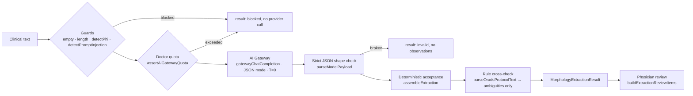

# AI Text Extraction (Medical Intelligence — TASK 04)

**Status:** implemented (TASK 04 + 04.1 semantic-integrity fixes), not exposed through an API route or UI  
**Shared layer:** `@repo/morphology-core/extraction` (`packages/morphology-core/src/extraction/`)  
**Web runner:** `apps/web/lib/ai/morphology-extraction/extract-morphology.ts`  
**Contracts:** [`MORPHOLOGY_FOUNDATION.md`](./MORPHOLOGY_FOUNDATION.md) · Blueprint §7 · ADR-MI-13…19

---

## 1. Purpose

Turn free clinical text (protocol fragments, morphology descriptions) into **candidate**
`MorphologyObservation`s for physician review.

The layer does **not**:

- classify (no O-RADS / BI-RADS / TI-RADS / MUSA call);
- confirm anything (output is never `confirmed`);
- infer absent findings;
- persist text or results;
- add a second AI gateway or a second canonical schema.

---

## 2. Pipeline



| Step | Where | Reused component |
|------|-------|------------------|
| Guards | package (injected) | `detectPhi` (`lib/security/phi-detection.ts`), `detectPromptInjection` (`lib/ai/sonogyn-chat/security/prompt-injection.ts`) |
| Quota | web runner | `assertAiGatewayQuota` (checked only after local guards pass) |
| LLM call | web runner | `gatewayChatCompletion` — existing provider chain and failover |
| Prompt | package | feature catalog generated from the **existing registry** |
| Validation / mapping | package | `validateObservation`, registry, adapter specs |
| Cross-check | package (type-only) + web | `parseOradsProtocolText` |
| Review rows | package | `confirmObservation` stays the only way to confirm (next phase) |

The package is provider-agnostic: it receives a `complete()` function. Web binds it to the
gateway; tests bind it to fixed responses. Mobile uses the same contract via a future server
endpoint (Phase C) — there is no second implementation.

---

## 3. Contracts

### 3.1 Input

`runMorphologyExtraction({ text, complete, guards, ruleCrossCheck?, registry?, now?, extractionId?, maxChars? })`  
Web: `extractMorphologyFromText({ text, userId }, deps?)`.

Max input: 8000 characters (configurable).

### 3.2 Model payload (untrusted)

The model must return `{ subjects[], mentions[] }` — JSON Schema exported as `MODEL_PAYLOAD_JSON_SCHEMA`.

- **subject:** `ref, site, laterality, lateralityText, sourceText`
- **mention:** `subjectRef, featureId, site, assertion (affirmed|negated|suspected|uncertain|not_assessed), valueCode, valueCodes, present, text, measurementText, sourceText, extractionConfidence, note` (prompt v1 `hedged` accepted as alias of `uncertain`)

Unknown keys (e.g. `status`) make that mention a `schema_violation`; its text is kept.

### 3.3 `MorphologyExtractionResult`

| Field | Meaning |
|-------|---------|
| `extractionId` | stable id; also prefixes observation / subject ids |
| `observations` | `MorphologyObservation[]` from `@repo/morphology-core` (no new schema) |
| `evidence` | per observation: text fragments with offsets, statement assertions, raw measurement text, synonym normalization |
| `subjects` | lesions / organs with verified laterality |
| `unresolvedMentions` | everything not mapped, with reason and original text |
| `ambiguities` | hedged statements, conflicts, unverified laterality, rule-parser disagreements, implausible sizes |
| `missingInformation` | features an engine will need that the text did not state (never observations) |
| `sourceTextReference` | `{ charLength, fingerprint }` — the text itself is not copied |
| `extractionModel` | `{ provider, model }` from the gateway |
| `promptVersion` | `mi-text-extraction.2026-11-06.v2` |
| `extractionTimestamp` | ISO-8601 |
| `validationStatus` | `valid · valid_with_issues · invalid · blocked · provider_error` |
| `blockReason` | `phi_detected · prompt_injection · empty_text · text_too_long · quota_exceeded` |
| `issues` | reasons, never containing input text |

Each observation carries: `feature`, `anatomy`, `value` / `measurement` + `unit`, `status`,
`source = ai_text_extraction`, `confidence`, `laterality`, `rawText` (verbatim fragment).
Emitted statuses: `suggested · uncertain · not_assessed · contradicted` — never `confirmed` or `not_applicable`.
All extraction output is **pending review** (`isPendingReview`: AI source, no `confirmation`).

---

## 4. Medical extraction rules and how they are enforced

| Rule | Enforcement (deterministic, after the model) |
|------|----------------------------------------------|
| 1. AI does not confirm | Status assigned by code. Model-supplied `status` → `schema_violation`. Final invariant rejects any status outside `suggested/uncertain/not_assessed/contradicted`, any non-AI source, any observation without `rawText` |
| 2. Absence ≠ negative | A negative value (`present=false`, or registry "absent" codes such as papillae `"0"`, flow `"none"`) requires a negation cue inside its fragment, else `negation_without_cue`. Unmentioned features become `missingInformation`, never observations |
| 2a. Absence ≠ not assessed | `not_assessed` requires an explicit phrase in the fragment (§4.1), else `not_assessed_without_cue` |
| 3. Explicit negations kept | «Солидных компонентов не выявлено» → `present=false`, `suggested`, evidence assertion `negated`. «не оценивался» is **not** a negation (excluded from negation cues) |
| 4. Uncertainty kept | `suspected` / `uncertain` → `status: uncertain`. If the model says `affirmed`/`negated` but the fragment is hedged («подозрение на», «возможно», «нельзя исключить», «?») the code downgrades and records `hedged_statement` |
| 5. Anatomy not mixed | Mention site must be compatible with the feature's anatomy (`SITE_TO_ANATOMY`); endometrium / cervix have no registered features → unresolved |
| 5a. Concepts not mixed | Solid-component features need «солидный», papillary features need «папиллярный» in the fragment (`CONCEPT_CUES`), else `concept_mismatch` (§4.3) |
| 6. Laterality not invented | Subject side kept only if `lateralityText` occurs in the text and contains a side word (`правильной формы` is not a side word); phrases or fragments naming both sides → side unset + `laterality_conflict` |
| 7. Units | Raw `measurementText` parsed by code; decimal-shift conversion (no float drift): `35 мм`, `3,5 см`, `0,035 м` → 35 mm. Raw text kept in `evidence.measurementText` and `rawText` |
| 8. No merged features / no silent choice | One observation per (subject, feature). Any disagreement (values, sizes, not_assessed vs value) → one `contradicted` observation with all alternatives and fragments (§4.2) |
| Registry only | Unknown `featureId` → `unknown_feature`; `featureId: null` → `model_unmapped`; the registry is never extended from model output |
| Source fidelity | Every fragment must occur in the input (`source_not_found_in_text` otherwise) |

### 4.1 Explicit «not assessed»

Recognized phrases (RU/EN, `hasNotAssessedCue`): «не оценивался/оценена/…», «не удалось оценить»,
«оценить невозможно», «оценка затруднена», «невозможно/затруднительно оценить», «не исследовался»,
«не проводилось / не выполнялось» (e.g. ЦДК), «not assessed / evaluated», «could not be assessed».

| Model output | Fragment | Result |
|--------------|----------|--------|
| `assertion: not_assessed`, no value | has phrase | `status: not_assessed`, `value: null`, evidence `not_assessed` |
| `assertion: not_assessed` | no phrase | `not_assessed_without_cue` (unresolved) |
| `assertion: not_assessed` + a value | has phrase | `inconsistent_not_assessed` |
| `assertion: negated` (e.g. flow `none`) | has phrase | **downgraded** to `not_assessed`, negative value discarded, `not_assessed_statement` ambiguity |
| affirmed positive value | has phrase | `inconsistent_not_assessed` |
| — (not mentioned) | — | no observation; `missingInformation: not_mentioned` |

A stated not_assessed on an engine must-state feature is reported as
`missingInformation: explicitly_not_assessed`. Adapters still block on it (ADR-MI-14), and an AI
not_assessed is pending review until `acceptObservationStatus()` (ADR-MI-18).

### 4.2 Contradictions

| Case | Observation |
|------|-------------|
| «определяется» vs «не определяется» | `contradicted`, `alternatives: [true, false]` |
| 35 мм vs 48 мм | `contradicted`, `alternatives: [{quantity 35 mm}, {quantity 48 mm}]`, `measurementText: "35 мм | 48 мм"` |
| «не оценивался» vs «умеренный» | `contradicted`, `alternatives: [{not_assessed}, {enum moderate}]` |
| right vs left for one finding | side unset on all its observations + `laterality_conflict` with all fragments |

All fragments stay in `evidence[].fragments`; one assertion per fragment. Adapters block on any
`contradicted` feature and on intra-finding laterality disagreement (ADR-MI-17).

### 4.3 Papillary projection vs solid component vs mural component

| Text | Mapped | Rejected |
|------|--------|----------|
| «папиллярное разрастание 6 мм» | `papillary_projection_count` | solid component, solid diameter (`concept_mismatch`) |
| «пристеночный компонент 8 мм» | — | solid and papillary (`concept_mismatch`) |
| «солидный компонент 12 мм» | solid component + diameter | — |

The solid component is never inferred from papillae. The O-RADS adapter blocks papillae with a stated
`solidComponent = false` (`inconsistent_features`) because the existing mapper would discard them (ADR-MI-19).

---

## 5. Confidence vs clinical certainty

| Concept | Where | Meaning |
|---------|-------|---------|
| Extraction confidence | `observation.confidence.score` (`method: model_self_report`) | How sure the extractor is it read and mapped the fragment |
| Statement certainty | `observation.status` (`uncertain` / `not_assessed` / `contradicted`) + `evidence[].assertions` | How the text states the finding |
| Clinical truth | — | Only physician confirmation (`confirmObservation`) |

When several fragments support one observation, the **minimum** confidence is kept.  
No code path promotes status from confidence. Per ADR-MI-15 (decided) there is **no** `assertion`
field on `MorphologyObservation`: status is the current clinical state, assertions are per-fragment
evidence (a confirmed finding may come from an uncertain sentence).

---

## 6. Validation layers

1. JSON parse (one optional ```json fence tolerated).
2. Envelope shape (subjects/mentions arrays, unique subject refs) — failure ⇒ `invalid`.
3. Per-mention strict shape (all keys, no extras, confidence ∈ [0,1]) — failure ⇒ that mention `schema_violation`.
4. Fragment located in text.
5. featureId in registry.
6. Site ↔ anatomy compatibility.
7. Value type / allowed code / synonym normalization / unit parsing.
8. Concept guard (papillary / solid).
9. Not-assessed, negation and hedge cues.
10. Laterality conflict check.
11. Grouping, contradiction detection (incl. quantity / not_assessed alternatives).
12. `validateObservation` on every result + invariant (allowed statuses, source = AI, `rawText` present).

Invalid output never reaches engines; in addition, adapters accept only `confirmed`
observations by default, so even valid extraction output cannot feed an engine until a physician confirms it.

---

## 7. Security

| Control | Behaviour | Test |
|---------|-----------|------|
| PHI | Existing `detectPhi` blocks before quota and provider; result never echoes the text | web + package |
| Prompt injection | Existing `detectPromptInjection` blocks before the provider | web + package |
| In-text instructions | Text wrapped in `<clinical_text>`; nested tags stripped; system prompt marks it as untrusted data; model output is re-validated regardless | package |
| Provider failover | Existing gateway chain; no new provider code | — |
| Quota | `assertAiGatewayQuota` before the provider call | web |
| Logging | Result `issues` contain reasons only; no persistence added | package |
| Server-only | LLM call lives in `apps/web/lib`; no route exposes it yet | — |

---

## 8. Example

Input (Blueprint §7.1 + one sentence):

> В левом яичнике образование округлой формы 45 мм, с анэхогенным содержимым, неоднородной структурой и папиллярным разрастанием 6 мм. Кровоток при ЦДК не оценивался.

Result (model response stubbed — the stub deliberately also maps the papilla size to the solid
diameter; real output of the pipeline, `validationStatus: valid_with_issues`):

| feature | value | status | laterality | conf. | rawText |
|---------|-------|--------|-----------|-------|---------|
| adnexa.lesion_length | 45 mm | suggested | left | 0.9 | образование округлой формы 45 мм |
| adnexa.cyst_content_echogenicity | anechoic | suggested | left | 0.95 | с анэхогенным содержимым |
| adnexa.papillary_projection_count | 1 | suggested | left | 0.8 | папиллярным разрастанием 6 мм |
| adnexa.blood_flow | — | **not_assessed** | left | 0.9 | Кровоток при ЦДК не оценивался |

- `unresolvedMentions`: «неоднородной структурой», «округлой формы» (`model_unmapped`);
  «папиллярным разрастанием 6 мм» as solid diameter (`concept_mismatch` — a papilla size is not the
  solid-component diameter).
- `missingInformation`: lesion_kind, structure, solid_component, solid_component_contour, acoustic_shadows,
  iota_color_score, ascites, peritoneal_nodules (`not_mentioned`), `context.menopause`.
- «Кровоток … не оценивался» is a stated not_assessed — **not** a negative flow value.
- `toOradsProInput` on this result fails: every observation is pending review, and hard requirements are missing.

---

## 9. Golden tests

`packages/morphology-core/src/extraction/__tests__/golden.test.ts` (model responses fixed, several deliberately unsafe):

| # | Scenario | Key assertion |
|---|----------|---------------|
| 01 | Simple ovarian cyst | 4 suggested observations, laterality left, nothing invented |
| 02 | Septations | 6 separate observations (dims from triplet, count, thickness) |
| 03 | Solid component | boolean + diameter |
| 04 | Papillary projections | count + surface |
| 05 | Explicit negation | `present=false`, `suggested`, assertion `negated` |
| 06 | Hedged papillae, model says affirmed | downgraded to `uncertain` + ambiguity |
| 07 | Blood flow not mentioned; adversarial negatives | all rejected; missing info listed |
| 08 | Left and right ovary | two subjects, correct sides |
| 09 | mm / cm / m | all exactly 35 mm; raw kept |
| 10 | Two lesions in one ovary | no false contradiction |
| 11 | Uterus + endometrium | endometrium unmapped; JZ-on-endometrium rejected |
| 12 | Ovary + pelvis + uterus | ascites without side; uterine feature on ovary rejected |
| 12b | Side not stated | laterality left unset + ambiguity |
| 13 | Contradiction | one `contradicted` observation; never reaches engine |
| 14 | Unknown term | preserved; registry unchanged |
| 15a | Broken model JSON | `invalid`, no observations |
| 15b | Number without unit | `unit_unparsed` |
| 15c | Model sends `status: confirmed` | `schema_violation`, text kept |

Invariants over all golden results: no `confirmed`; no `not_assessed` / `not_applicable` generated;
every observation contract-valid with fragments present in the text; negatives always negated;
suggested observations never used by engines by default; unresolved mentions keep text.

`semantic-integrity.test.ts` (TASK 04.1): cue detection; four not_assessed phrases; REGRESSION A1
(«не оценивался» read as negation); not_assessed without cue / with value; absence; explicit negative;
contradictions (boolean, 35 vs 48 mm, not_assessed vs value); laterality conflicts incl. «правильной
формы»; REGRESSION C1/C2 (papilla → solid, «пристеночный»); adapters blocking contradicted / quantity
conflicts / laterality conflict / papillae with solid=false; AI not_assessed pending review; alternative-only
value kinds; invariants across all results.

`pipeline-security.test.ts`: guard ordering, empty/oversized text, provider error, prompt
hardening, unit normalization table, review contract.  
`apps/web/lib/ai/morphology-extraction/__tests__`: real `detectPhi` / `detectPromptInjection`,
quota gating, gateway binding, rule-parser cross-check.

Run: `pnpm test:morphology-core` · `pnpm test:mi-extraction` (both in CI).

---

## 10. Limitations

- Model quality is not measured here: golden tests validate the acceptance layer with fixed responses. A live-model evaluation set is Phase H.
- No registered features for endometrium, cervix, FIGO, FMF, biometry; RU TI-RADS; BI-RADS MMG → such mentions are unresolved.
- Clinical context (menopause, age, cycle day) is not extracted as morphology; listed as `context.menopause` in missing information.
- Not-assessed, negation, hedge and concept cue lists are heuristic RU/EN patterns; a cue outside the quoted fragment is not seen.
- The concept guard is lexical: «солидный»/«папиллярный» must appear in the fragment; legitimate synonyms (e.g. «тканевой компонент») are rejected conservatively.
- `parseOradsProtocolText` misses some case forms (e.g. «солидным компонентом»); cross-check is a weak second opinion.
- No API route / mobile access yet; quota usage of extraction calls is not logged to `ai_chat_events` (to be added with the MI analysis event in Phase C).

---

## 11. Next: MI Orchestrator (Phase C, separate approval)

1. Authenticated route (Zod body) calling `extractMorphologyFromText`; metadata-only event logging.
2. Physician review UI on `ExtractionReviewItem` → `confirmObservation` / edit / reject.
3. Only confirmed observations → `to<Engine>Input` (complete) → existing `executeClinicalTool` engines.
4. Evidence retrieval and abstention per Blueprint §8.
