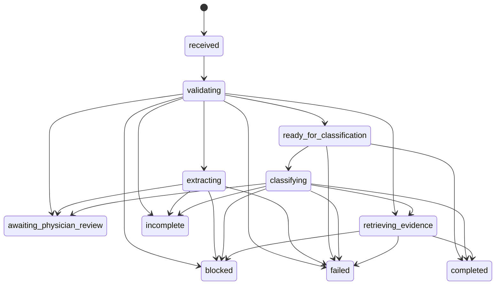

# MI Orchestrator — Implementation (Phase C / TASK 05)

**Package:** `@repo/medical-intelligence` (`packages/medical-intelligence`) — shared Web / React Native  
**Web binding:** `apps/web/lib/ai/mi/` · **API:** `POST /api/mi/analyze` (behind `MI_ORCHESTRATOR_ENABLED`, off by default)  
**Basis:** Blueprint §4 / §13 (package agreed), ADR-MI-01…19, `MORPHOLOGY_FOUNDATION.md`, `AI_TEXT_EXTRACTION.md`  
**Decisions:** ADR-MI-20…23 in [`SONOGYN_MEDICAL_INTELLIGENCE_ADR.md`](./SONOGYN_MEDICAL_INTELLIGENCE_ADR.md)

---

## 1. Pre-implementation audit (component map)

| Component | Location | Decision |
|-----------|----------|----------|
| AI Gateway + provider failover | `apps/web/lib/ai/gateway`, `sonogyn-chat/provider-failover.ts` | Reused indirectly (extraction runner, evidence LLM synthesis). Orchestrator makes **no** provider calls |
| AI Text Extraction | `@repo/morphology-core/extraction`, `apps/web/lib/ai/morphology-extraction` | Reused as `extractText` dependency (guards + quota inside) |
| Morphology Core | `@repo/morphology-core` | Reused: adapters (`to*Input`, strict), `validateObservations`, `confirmObservation`, `acceptObservationStatus`, `isPendingReview` |
| Existing orchestrator | `apps/web/lib/ai/orchestrator.ts` (`runClinicalCopilotOrchestrator`) | **Different responsibility** — parallel fan-out of 7 LLM/rule agents producing hypotheses for Copilot. Not extended (would mix LLM hypotheses with deterministic gating); untouched |
| `executeClinicalTool` | `apps/web/lib/ai/sonogyn-chat/tools/execute.ts` | **Not used for routing** — see §6.1 (its Zod schemas strip engine fields → engine defaults) |
| Classification engines | `@repo/orads-us/pro`, `@repo/birads-us`, `@repo/tirads-acr`, `@repo/musa-framework` | Called through their public APIs, unchanged |
| `searchEvidenceUnified` / Evidence Assistant | `@repo/evidence-retrieval`, `app/api/evidence/assistant/ask` | Same chain reused in `evidence-binding.ts` (route logic is inline; mirrored call order, no new retrieval logic) |
| `postValidateEvidenceAnswer` | `sonogyn-chat/evidence-answer-validate.ts` | Reused on `formatEvidenceSourcedChatReply(answer)` — same as the chat evidence agent |
| Quotas / cost | `assertAiGatewayQuota` | Reused inside the extraction runner and evidence binding; no second quota |
| Rate limit | `consumeRateLimit` + `RL.evidenceAssistant` | Reused in the API route |
| PHI / injection | `detectPhi`, `detectPromptInjection` | Reused; run by the orchestrator on **every** text field before any provider, and again by the extraction runner |
| Not ready / excluded | IOTA, RU TI-RADS, BI-RADS MMG, FIGO, FMF, LN-RADS | Rejected as `unsupported_classification` |

Findings outside Phase C scope (reported, not changed):

1. **`executeClinicalTool` drops fields** — verified: same O-RADS input → category **5** via `calculateORADS`, **4** via the chat tool (echogenicity, papillae, colour score, shadows, ascites stripped); TI-RADS size key mismatch (`maxDiameterMm` vs `largestDiameterMm`) loses FNA logic. Affects the existing chat assistant. **Fixed in TASK 05.1 (ADR-MI-24).**
2. **Evidence Assistant route** sends the user query to external providers without `detectPhi`. MI runs the guard before its evidence call.

Found and fixed during the web build (additive, no medical logic — ADR-MI-23):

3. The Phase B runner imported `parseOradsProtocolText` from the `@repo/orads-us` root, which re-exports
   React navigator hooks → `next build` failed once the route pulled it into the server graph. Now imported
   from the server-safe subpath `@repo/orads-us/parse-protocol-text`.
4. `@repo/musa-framework` (ESM source) lacked `"type": "module"`, so named imports failed in Node and the
   workaround produced a webpack warning. Flag added; workarounds removed; MUSA page and tests unchanged.
5. `AssistantAnswer` is imported through the new type-only subpath `@repo/evidence-retrieval/types` so the
   package does not type-check the whole retrieval graph (DOM `fetch` types) under the RN config.

---

## 2. Architecture

```mermaid
flowchart TB
  C[Web / Expo client] -->|POST /api/mi/analyze<br/>flag + auth + rate limit + Zod| R[route.ts]
  R --> W[run-mi.ts · idempotency per user]
  W --> O[runMedicalIntelligence<br/>@repo/medical-intelligence]
  O -->|guards first| G[detectPhi · detectPromptInjection]
  O -->|free_text| X[extractMorphologyFromText<br/>guards · quota · AI Gateway]
  O -->|structured| RG[Physician Review Gate]
  RG --> RT[Routing adapters]
  RT --> A[morphology-core to*Input strict]
  A --> E[calculateORADS · evaluateBirads · evaluateAcrTirads · calculateAdenomyosisScore]
  O -->|question / includeEvidence| EV[runMiEvidence<br/>quota · searchEvidenceUnified · synthesis · postValidateEvidenceAnswer]
  O --> RES[MedicalIntelligenceResult · plain JSON]
```

The orchestrator decides **which** component runs and **which gate stops**. It has no clinical
math, no gateway, no retrieval, no persistence.

### Paths (not every request passes every stage)

| inputType | Stages |
|-----------|--------|
| `free_text` | validating → extracting → awaiting_physician_review \| incomplete \| blocked \| failed |
| `structured_morphology` | validating → review gate → awaiting_physician_review \| ready_for_classification → completed (readiness only) |
| `classification_request` | validating → review gate → ready_for_classification → classifying → completed \| incomplete \| awaiting_physician_review [→ retrieving_evidence → completed] |
| `clinical_question` | validating → retrieving_evidence → completed \| failed \| blocked |

Free text **never** reaches classification in the same request: extracted observations are all pending review.

---

## 3. Contracts (`src/contracts.ts`)

`MedicalIntelligenceRequest` (discriminated by `inputType`): `free_text {text}`,
`structured_morphology {observations, reviewDecisions?, reviewedAt?}`,
`classification_request {engineId, observations, reviewDecisions?, clinicalContext?, subjectId?, includeEvidence?}`,
`clinical_question {question, corpusMode?}`; all with optional `requestId`, `idempotencyKey`.

`MedicalIntelligenceResult`: `requestId, status, inputType, stateHistory, extraction (Phase B result as-is),
morphology {observations, review}, classification, evidence, warnings, unresolvedIssues, provenance,
modelVersion, processingMetadata, disclaimer`.

Types reused, not duplicated: `MorphologyObservation`, `MorphologyValue`, `OradsClinicalContext`,
`AdapterIssue`, `MorphologyExtractionResult`, `AssistantAnswer` (via the new type-only subpath
`@repo/evidence-retrieval/types`).

Result separation for the future UI:

| Section | Content |
|---------|---------|
| `extraction` | AI interpretation (suggested, fragments, ambiguities) |
| `morphology.review` | pending / confirmed / corrected / rejected / accepted-as-stated / contradictions / not_assessed |
| `classification` | engine id + version, exact engine input, raw engine output, category label, or abstention (available / missing / needs clarification / reason) |
| `evidence` | references with provider metadata, validation result, limitations |
| `provenance` | AI-suggested ids, physician-confirmed ids, engine, evidence providers |

The result is normalized to plain JSON before returning (engine outputs contain `undefined` fields),
so in-process callers see exactly what Web / Expo clients receive.

---

## 4. State machine (`src/state-machine.ts`)



Illegal transitions throw `IllegalTransitionError` (e.g. `extracting → classifying`). Terminal:
`completed · incomplete · blocked · failed · awaiting_physician_review`.

| Status | Meaning | Examples |
|--------|---------|----------|
| `incomplete` | Not enough data | missing required feature, missing menopause, no size for TI-RADS FNA, nothing extracted, engine placeholder output |
| `blocked` | Not allowed to continue | PHI, prompt injection, quota, invalid request, invalid review decision, invalid observation contract, unsupported engine |
| `failed` | Technical error | provider error, invalid model JSON, evidence retrieval error / all providers down, engine exception |
| `awaiting_physician_review` | Physician action required | pending AI observations, unresolved contradiction, laterality conflict, papillae with solid=false, conflicting confirmed values |

Technical failures never produce a medical result; messages are generic (no stack, no provider detail).

---

## 5. Physician Review Gate (`src/review-gate.ts`)

Pending = `isPendingReview(o)` (AI source, no confirmation — any status) **or** `status === "suggested"`.

| Decision | Allowed on | Effect |
|----------|-----------|--------|
| `confirm` | suggested / uncertain with a value | `confirmObservation` (provenance kept) |
| `correct` | any | `confirmObservation` with patch; recorded before/after |
| `reject` | any | removed from the working set; recorded |
| `accept_status` | not_assessed / not_applicable / uncertain | `acceptObservationStatus` — never becomes a value |
| `choose_alternative` | contradicted | explicit index → value / quantity / not_assessed |

Refused (→ `blocked`): unknown id, duplicate decision, `confirm` on contradicted (`contradiction_requires_resolution`),
`confirm` on not_assessed (`status_not_confirmable`), out-of-range alternative, any result that fails contract validation.
There is no auto-confirm, no default alternative, and `allowPartial` is never passed by the orchestrator.

Not-assessed flow: AI not_assessed → pending → `accept_status` → stated not_assessed → adapter must-state
gate → `incomplete` (the field stays absent; never `false` / `"0"`).

---

## 6. Classification routing (`src/routing.ts`)

| engineId | Adapter (morphology-core) | Engine API | Version stamp |
|----------|---------------------------|------------|---------------|
| `orads_us_pro` | `toOradsProInput` (+ clinicalContext) | `calculateORADS` | `O-RADS US v2022` (same label as `executeClinicalTool`; no exported constant) |
| `birads_us` | `toBiradsUsInput` | `evaluateBirads` | `BI_RADS_VERSION` |
| `tirads_acr` | `toTiradsAcrInput` | `evaluateAcrTirads` | `result.engineVersion` (`acr-2017-v3`) |
| `musa_adenomyosis` | `toMusaAdenomyosisInput` | `calculateAdenomyosisScore` | `musa-adenomyosis <knowledge version>` |

Before an engine call: review gate (pending, contradictions) on the engine's anatomies/subject,
contract validation, then strict adapter conversion (confirmed only; completeness gate; laterality;
contradictions; units; papillae/solid consistency). Adapter errors map to
`awaiting_physician_review` (contradicted, laterality_conflict, inconsistent_features, conflicting_values),
`blocked` (invalid_observation) or `incomplete` (missing / incomplete_for_engine / unsupported_*).

Defence in depth: an O-RADS placeholder output (`riskText` «Нужны данные для расчёта» /
«Требуется переклассификация», or the «Недостаточно структурированных признаков» branch) is an
abstention (`engine_abstained` → `incomplete`), never a category. This check is tied to engine strings.

### 6.1 Why not `executeClinicalTool`

Its tool schemas are `z.object` (unknown keys stripped). O-RADS keeps only menopause, lesionKind,
structure, solidComponent, dimensions, bloodFlow, ageYears; TI-RADS expects `maxDiameterMm`. Routing
through it would silently re-introduce the defaults Phase A blocks. Fixing the chat tool is a separate task.

### 6.2 Partial results

None in Phase C. There is no agreed scenario where an engine + adapter guarantee a correct partial result.

---

## 7. Evidence integration

`runMiEvidence` (web) = quota → `searchEvidenceUnified` → `synthesizeWithLlm` (or rules
`synthesizeEvidenceAnswer` when nothing is found) → `formatEvidenceSourcedChatReply` →
`postValidateEvidenceAnswer`. The orchestrator maps it with `buildEvidenceSection`:

| Situation | `evidence.status` | Request status |
|-----------|-------------------|----------------|
| citations returned | `found` | completed |
| no citations / insufficient | `insufficient`, `references: []` | completed |
| all providers failed and no records | `failed` | failed (question) / completed + warning (after classification) |
| exception | `failed` (generic error) | same as above |
| quota | `failed` + blocked flag | blocked (question) / completed + `evidence_blocked` warning |

Reference fields kept when the provider supplies them: `sourceId, provider, title, url, recordType,
year, journal, doi, pmid, section, passage (provider quote), evidenceLevel`. **Not available from the
evidence stack** (listed in `limitations`, never invented): document version / edition, full
publication date, page numbers. Classification evidence queries are deterministic templates per engine.

---

## 8. Security and cost control

| Control | Implementation |
|---------|----------------|
| PHI | `detectPhi` on all text fields (free text, question, `rawText`, text values, correction text, reject reason) before any provider; extraction runner checks again |
| Prompt injection | `detectPromptInjection` on the same text before any provider; extraction prompt keeps text as untrusted data |
| No bypass of extraction | free text can only produce pending observations; `extracting → classifying` is an illegal transition |
| Quota | `assertAiGatewayQuota` inside the extraction runner and the evidence binding (no new quota) |
| Rate limit | `consumeRateLimit("mi-analyze:<user>", RL.evidenceAssistant)` |
| Repeated calls | per-user `idempotencyKey` → in-memory coalescing for 60 s (in-flight shared); ≤1 extraction and ≤1 evidence call per request (`processingMetadata.providerCalls`) |
| Secrets | technical errors are generic; tests assert secret-looking exception text never appears in results |
| Logging | route uses `safeLog` (dev-only, redacting) with requestId / inputType / status / call counts — no text |
| Auth | `requireSupabaseUserFromRequest` (cookie or Bearer), no open-access path |
| Rollout | `MI_ORCHESTRATOR_ENABLED` must be `1`/`true`; otherwise 404 |
| Correlation | `requestId` (client or generated) → `extractionId`, observation id prefixes, result, log line |

Limitations: idempotency cache is per server instance (no shared store — Phase C forbids persistence);
MI provider usage is not yet written to `ai_chat_events`, so it is limited by rate limit and quota
checks but not counted in daily quota totals.

---

## 9. Web / Mobile

- Contracts are plain JSON (tested: `JSON.parse(JSON.stringify(result))` deep-equals every result).
- `@repo/medical-intelligence` has no Node/DOM globals; typechecks under `apps/mobile/tsconfig.json` (Expo) and `apps/web/tsconfig.json`.
- Mobile calls the same endpoint with `Authorization: Bearer` (existing pattern in `requireSupabaseUserFromRequest`). No mobile client or UI added in this phase.
- Web: `@repo/medical-intelligence` added to `apps/web` dependencies and `transpilePackages`.

---

## 10. Test coverage

`packages/medical-intelligence/src/__tests__/` — 39 tests (real engines; real Phase B pipeline with stub model; stub evidence):

| # | Scenario | Assertion |
|---|----------|-----------|
| 1 | free text → extraction | `awaiting_physician_review`, never classified, requestId → extractionId |
| 2–5 | confirmed → O-RADS / BI-RADS / TI-RADS / MUSA | engine output identical to a direct engine call; no field stripped |
| 6 | suggested observation | not sent to engine; explicit confirm lets it through, provenance kept |
| 7 | contradicted | awaiting review; `confirm` refused; `choose_alternative` resolves |
| 8 | laterality conflict | awaiting review |
| 9 | not_assessed | pending → `confirm` refused → `accept_status` → incomplete, never negative |
| 10 | incomplete / blocked | missing size / menopause → incomplete; IOTA / RU TI-RADS / MMG / FIGO → blocked; invalid contract → blocked; O-RADS placeholder → abstention |
| 11–12 | PHI / injection | blocked before extraction / evidence; PHI not echoed |
| 13 | evidence errors | failed (question), all-providers-down ≠ insufficient, classification kept + warning |
| 14 | provider errors | provider error / broken JSON / thrown runner → failed, no secrets |
| 15 | repeats | same key → one provider call (concurrent + sequential); ≤1 call per stage |
| 16 | citations | provider metadata only, validation carried, limitations listed |
| — | state machine | legal paths, illegal transitions throw, terminal states |
| — | invariants | every history follows `MI_TRANSITIONS`; engine results only from physician-reviewed observations; results are plain JSON |

`apps/web/lib/ai/mi/__tests__/mi-web.test.ts` — 9 tests: real `detectPhi` / `detectPromptInjection`, real extraction
runner, real `postValidateEvidenceAnswer` (passes on valid citations, catches an invented PMID), evidence errors,
quota → blocked, per-user idempotency, Zod request schema (no extra fields, no auto actions, size limits).

CI: `pnpm test:medical-intelligence` (package + web binding).

---

## 11. Limitations

- Four engines only; IOTA / RU TI-RADS / MMG / FIGO / FMF / LN-RADS need readiness review.
- O-RADS placeholder detection depends on engine output strings.
- `executeClinicalTool` field loss — fixed in TASK 05.1 (ADR-MI-24). Evidence Assistant PHI gap — existing issue, not fixed here.
- No persistence: review decisions must be re-sent with the observations on each request.
- Idempotency is per instance; quota usage of MI calls is not logged yet.
- Evidence references cannot include version / page — the stack does not provide them.

---

## 12. Next steps (separate approval)

1. Fix `executeClinicalTool` schemas (pass full engine inputs) — chat safety.
2. Add `detectPhi` to the Evidence Assistant route.
3. Metadata-only MI usage events in the existing `ai_chat_events` for quota accounting.
4. Physician review UI on `ExtractionReviewItem` + `ReviewDecision` (Web, then Expo).
5. Readiness review for IOTA (reuse `mapSreToAdnexInput`) and RU TI-RADS.
