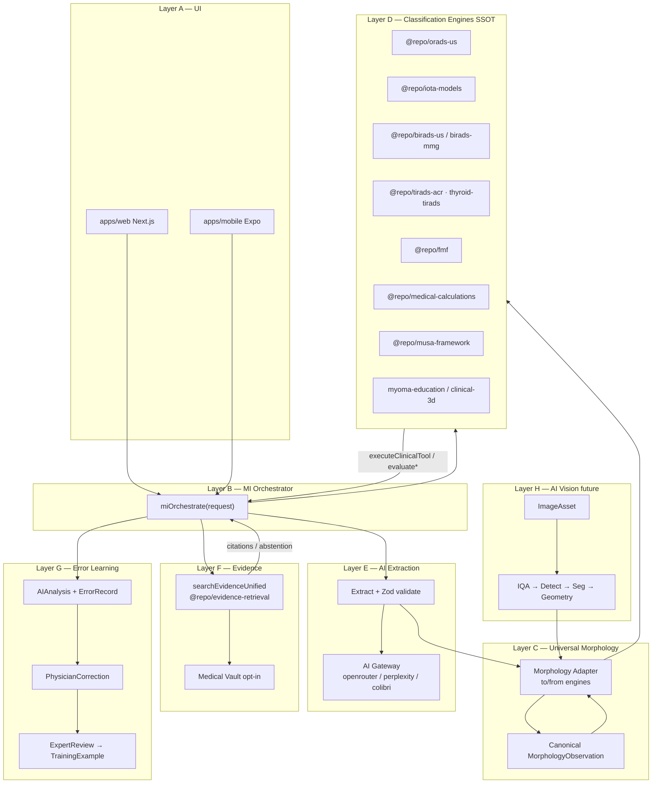
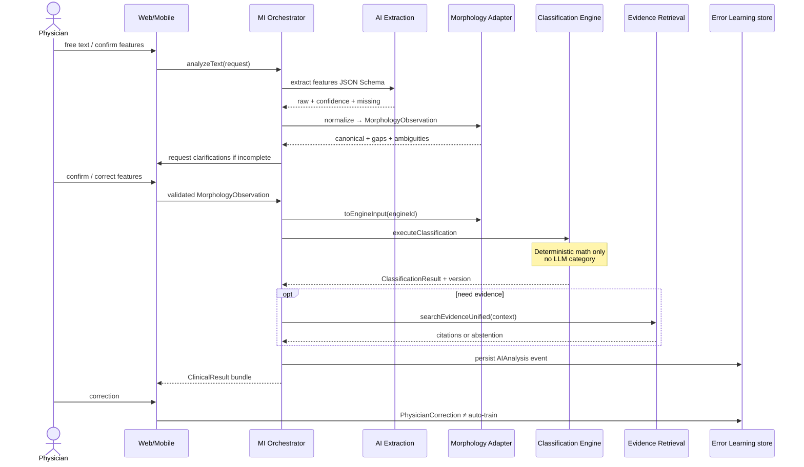
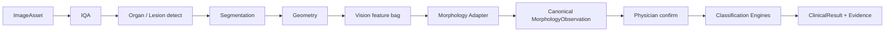

# SonoGyn Medical Intelligence — Architecture Blueprint

**Document:** `SONOGYN_MEDICAL_INTELLIGENCE_BLUEPRINT.md`  
**Status:** v0.2 — design + implemented layers C (morphology) and E (text extraction); see §18 Amendment log  
**Basis:** TASK 01 Architecture Audit (2026-11-06) · HEAD context `copyright-cleanup`  
**Related ADR:** [`SONOGYN_MEDICAL_INTELLIGENCE_ADR.md`](./SONOGYN_MEDICAL_INTELLIGENCE_ADR.md)  
**Related:** [`adr/ADR-ORCH-evidence-retrieval.md`](./adr/ADR-ORCH-evidence-retrieval.md), [`adr/ADR-VEC-pgvector-first.md`](./adr/ADR-VEC-pgvector-first.md), [`emr-teaching-boundary.md`](./emr-teaching-boundary.md)

---

## 1. Goal

Единая интеллектуальная медицинская система поверх **существующего** SonoGyn Pro:

| Capability | Owner (principle) |
|------------|-------------------|
| Понимание языка врача | LLM via **existing** AI Gateway + extraction schemas |
| Нормализация морфологии | **Universal Morphology** (new adapter package, not new calc) |
| Проверяемые категории | **Existing** Classification Engines (`packages/*`) |
| Доказательные источники | **Existing** Evidence Retrieval + Vault (no second RAG) |
| Координация | **MI Orchestrator** (thin) |
| Обучение на ошибках | **Error Learning** (controlled datasets; no online learning) |
| УЗИ-изображения (future) | **AI Vision** → same Morphology Adapter |
| Web + Mobile | Shared contracts / `@repo/*` SSOT |

**Non-goal:** вторая платформа, LLM-замещение математики классификаций, uncontrolled fine-tune из thumbs.

---

## 2. Architecture overview

### 2.1 Mermaid — system diagram



### 2.2 Mermaid — text analysis data flow



### 2.3 Mermaid — vision path (future, same adapter)



---

## 3. Layer A — User Interface

### 3.1 Unified physician scenario

1. Задать вопрос / ввести описание / загрузить изображение (future).  
2. Получить **структурированные признаки** (proposed).  
3. **Подтвердить или исправить** (явный статус `confirmed` vs `inferred`).  
4. Запустить классификацию (engine picker или auto-suggest by domain).  
5. Увидеть категорию + explanation + limitations.  
6. При необходимости — Evidence с citations или честный abstention.  
7. Черновик протокола / заключения (reuse report-engine / orads assist).  
8. Отправить correction (physician) — не «лайк как обучение».

### 3.2 Ownership

| Surface | Path | Shared |
|---------|------|--------|
| Web clinical shell | `apps/web` | Calls MI API / packages |
| Mobile | `apps/mobile` | Same contracts via API or direct `@repo/*` for offline-safe engines |
| Calculators today | `/tools/calc/*`, OradsUnified, etc. | Remain; MI wraps, does not replace UI overnight |

**Parity rule:** medical numbers only from `@repo/*`; UI may differ, contracts must not.

---

## 4. Layer B — Medical Intelligence Orchestrator

### 4.1 Role

Тонкий координатор. **Запрещено** переносить сюда формулы O-RADS/IOTA/…

### 4.2 Responsibilities (ordered)

1. Accept request (`analyzeText` / `analyzeImage` / hybrid).  
2. Infer **domain** (ovary / breast / thyroid / uterus / obstetric / …) — reuse patterns from `inferClinicalDomain`, `us-vision/infer-domain`.  
3. Infer **task type** (classify / explain / evidence-only / protocol assist).  
4. Call AI Extraction (or skip if structured input provided).  
5. Morphology Adapter → canonical.  
6. Completeness / ambiguity gate.  
7. Map to engine input → `executeClassification`.  
8. Optional Evidence.  
9. Assemble `AIAnalysis` result.  
10. Persist analysis event + accept later corrections.

### 4.3 Placement (proposed)

| Item | Proposal |
|------|----------|
| Package | `@repo/medical-intelligence` (new) **or** `apps/web/lib/ai/mi/` initially with package promotion in Phase C |
| Prefer | New package early so mobile can import types without Next coupling |
| Reuse | `apps/web/lib/ai/orchestrator.ts` agents as **optional** sub-steps, not a second brain |
| Tools | Keep `executeClinicalTool` as engine façade for chat; MI calls same engines |

### 4.4 Existing glue to reuse

- `apps/web/lib/ai/gateway/*`  
- `apps/web/lib/ai/sonogyn-chat/tools/execute.ts` → `executeClinicalTool`  
- `packages/orads-us/src/assist/runOradsAssistPipeline.ts` (text→O-RADS without LLM)  
- `packages/evidence-retrieval` orchestrator  
- PHI / injection: `detectPhi`, `detectPromptInjection`

---

## 5. Layer C — Universal Morphology

### 5.1 Principle

**One canonical observation model**; **many adapters**.  
Do **not** merge ACR TI-RADS criteria with RU TI-RADS because both say «echogenicity».

### 5.2 Vocabulary conflict resolution

| Existing lexicon | Role after MI | Adapter |
|------------------|---------------|---------|
| O-RADS Pro `OradsInput` / `OradsUs2022Input` | Engine-native SSOT for O-RADS | `toOradsUs2022` / `fromOrads*` |
| NLP `OradsExtractedInput` | Ingress from free text | Map via existing `extractedToHints` → extend to canonical |
| `imaging-cds/lexicon-schemas` | Vision/assist feature bag | Map IDs → canonical features |
| TI-RADS ACR / RU enums | Modality-specific | Namespaced features `thyroid.acr.*` / `thyroid.ru.*` |
| MUSA / LN-RADS / breast | Modality-specific | Namespaced; no forced global enum collapse |

### 5.3 Canonical feature dimensions (examples)

`shape`, `contour`, `margin`, `echogenicity`, `echotexture`, `composition`, `solidComponent`, `cysticComponent`, `papillaryProjection`, `septation`, `vascularity`, `posteriorAcoustic`, `location`, `dimensions` — each as **feature definition** with applicability (`appliesTo: ovary_us | thyroid_us | …`).

### 5.4 Morphology Adapter API (implemented — see `MORPHOLOGY_FOUNDATION.md`)

```
to<Engine>Input(observations[], [context], options) → ToEngineResult<EngineInput>
from<Engine>Input(engineInput, options)            → { observations[], lossy[], context }
validateObservation(obs, registry)                  → ValidationIssue[]
confirmObservation(obs, at, patch?)                 → MorphologyObservation   // explicit physician action
```

Statuses (six): `confirmed · suggested · uncertain · not_assessed · not_applicable · contradicted`.  
Provenance (five): `physician_input · structured_protocol · ai_text_extraction · ai_vision · imported_data`.  
Not mentioned → no observation (never coerced to negative). `not_assessed` is an explicit statement, not a default.

**Completeness gate (v0.2):** if an engine or its existing mapper would silently default an unstated
feature, the adapter blocks (`incomplete_for_engine`) unless the caller passes `allowPartial: true`,
which yields `completeness: "partial"`. Inputs whose absence makes `calculateORADS` return a placeholder
category 3 are hard requirements that block even with `allowPartial`.

### 5.5 Package (implemented)

`@repo/morphology-core` — types, feature registry, observation validation, engine adapters,
and the provider-agnostic text-extraction layer (`@repo/morphology-core/extraction`).  
Engine packages are imported with `import type` only: no runtime clinical math in this package.  
Engines do **not** depend on morphology-core.

---

## 6. Layer D — Classification Engines

### 6.1 Common engine contract

```ts
// Logical contract — not implemented in TASK 02
type ClinicalEngine = {
  id: EngineId;
  version: string;           // e.g. acr-2017-v3, O-RADS US v2022
  inputSchema: ZodType;      // engine-native OR via adapter
  validate(input): ValidationResult;
  execute(input): ClassificationResult;
  explain?(result): string[];
  evidenceHints?: string[];  // query seeds for Evidence, not invented cites
  limitations: string[];
};
```

`ClassificationResult` always includes: `engineId`, `engineVersion`, `category`/`score`, `rationale`, `missing[]`, `warnings[]`, `disclaimer`.

### 6.2 Engine registry (SSOT ownership)

| Engine ID | SSOT module | Entry function | Notes |
|-----------|-------------|----------------|-------|
| `orads_us_2022` | `@repo/orads-us` | `evaluateOradsUs2022` | Prefer over legacy tree for new MI path; keep Pro for UI parity |
| `orads_us_pro` | `@repo/orads-us/pro` | `calculateORADS` | Used by `executeClinicalTool` today |
| `iota_adnex` | `@repo/iota-models` | `calculateAdnex` | |
| `iota_lr2` | `@repo/iota-models` | `calculateLr2` | |
| `iota_simple_rules` | `@repo/iota-models` | `evaluateSimpleRules` | |
| `iota_srrisk` | `@repo/iota-models` | `calculateSimpleRulesRisk` | |
| `birads_us` | `@repo/birads-us` | `evaluateBirads` | Deprecate parallel `breast-classification` for MI |
| `birads_mmg` | `@repo/birads-mmg` | `evaluate*` | |
| `tirads_acr` | `@repo/tirads-acr` | `evaluateAcrTirads` | version `acr-2017-v3` |
| `tirads_ru` | `@repo/thyroid-tirads` | `evaluateTiradsRu` | **Separate** engine — never merge with ACR |
| `ln_rads_us` | `@repo/ln-rads-us` | LN score | |
| `musa_adenomyosis` | `@repo/musa-framework` | `calculateAdenomyosisScore` | |
| `figo_leiomyoma` | `@repo/myoma-education` calc **preferred** | `classifyFigo` | clinical-3d / clinical-uterus = UI/3D, not formula fork |
| `fmf_t1` | `@repo/fmf` | `assessFirstTrimesterScreening` | |
| `bishop` | `@repo/medical-calculations` | `bishopScore` | |
| `vbac_tolac` | `@repo/medical-calculations` | `assessVbacPreLabor` | Educational ≠ Grobman |
| `efw_hadlock` | `@repo/medical-calculations` | `efwHadlock*` | **SSOT**; obstetric-engine must call this (Phase A fix plan) |
| `ga_dating` | `@repo/medical-calculations` | `gestationalAge` / dating | |
| `afi` / `doppler_indices` | `@repo/medical-calculations` | respective | Norms: `@repo/medvedev-reference` |
| `cervical_length` | **Target:** `@repo/medical-calculations` | today mobile module | Move in Phase A/B |

### 6.3 Duplication resolution map

| Conflict | Keep as SSOT | Deprecate / wrap |
|----------|--------------|------------------|
| Hadlock EFW | `medical-calculations` | Inline in `obstetric-engine/biometry-engine.ts` → re-export |
| FIGO | `myoma-education` classifyFigo | 3D packages consume SSOT |
| Z-score T1 | `@repo/fmf` | clinical-3d anchors for viz only |
| Z-score T2/T3 | `@repo/obstetric-engine` + Medvedev curves | `percentiles.ts` simplified = education only, labeled |
| TI-RADS | Two engines ACR + RU | UI modes, not one scale |
| BI-RADS | `@repo/birads-us` | `breast-classification` legacy |
| Cervical length | packages (target) | mobile-owned logic |

### 6.4 Façade reuse

Extend conceptually `executeClinicalTool` / registry — do not invent parallel math wrappers in web-only code.

---

## 7. Layer E — AI Extraction

### 7.1 Scenario

Input: «В левом яичнике образование округлой формы 45 мм, с анэхогенным содержимым, неоднородной структурой и папиллярным разрастанием 6 мм».

Pipeline:

1. Domain = adnexal US.  
2. LLM (or rules-first O-RADS parse) → JSON per schema.  
3. Preserve **verbatim spans** + mapped canonical features.  
4. Normalize synonyms via feature definitions.  
5. Mark missing (e.g. menopause, color score).  
6. Mark ambiguities (heterogeneous vs non-simple content).  
7. UI clarification loop.  
8. Adapter → `orads_us_2022` input.  
9. **Engine** computes category — LLM does not.

### 7.2 Rules vs LLM (revised v0.2 — see ADR-MI-11 amendment / ADR-MI-13)

| Path | Role |
|------|------|
| LLM extraction (AI Gateway) | Produces candidate mentions with verbatim source spans |
| Deterministic validation (`@repo/morphology-core/extraction`) | Accepts/rejects every mention; assigns status/source; normalizes units |
| `parseOradsProtocolText` | **Cross-check only** — disagreements become ambiguities. It is not used to create observations because it infers negatives/defaults from absence (e.g. `vascularity: "none"` on any «не определяется», `lesionClass: "simple"` by default) and keeps no spans |
| `runOradsAssistPipeline` | Unchanged; not part of the extraction layer |

### 7.3 Validation (implemented)

- Strict JSON shape check (hand-written, RN-safe; no Zod in the shared package).  
- Every mention's source fragment must occur in the input text.  
- Negative values require a negation cue inside the fragment; laterality requires a side cue.  
- Unknown feature ids / values → `unresolvedMentions`, never dropped.  
- AI output is always `suggested` / `uncertain` / `contradicted` — never `confirmed`.  
- PHI (`detectPhi`) and prompt injection (`detectPromptInjection`) block before any provider call.  
- Gateway quotas unchanged (`assertAiGatewayQuota`).  
- Details: `AI_TEXT_EXTRACTION.md`.

---

## 8. Layer F — Medical Evidence

### 8.1 Decision

**Reuse only** `@repo/evidence-retrieval` + existing web synthesis (`synthesize-llm`, `postValidateEvidenceAnswer`).  
Align with ADR-ORCH: no LangChain/LlamaIndex.

### 8.2 Integration

| Concern | Design |
|---------|--------|
| Interface | `searchEvidence({ query, corpusMode, context: ClassificationResult? })` → wraps `searchEvidenceUnified` |
| Citations | Pass through existing claim/citation model |
| Vault empty | Surface `vaultStatus` (disabled / empty / ok) — never fake textbook |
| Abstention | Existing insufficient / emptyCorpusMessage; MI must show «источник не найден» |
| RCOG | Existing `corpusMode: rcog` / provider `rcog` |

### 8.3 Context seeding

Optional: `evidenceHints` from engine + classification rationale → query rewrite (Phase E).  
Do not invent grades.

---

## 9. Layer G — Error Learning Engine

### 9.1 Separation of concerns

| Layer | Source today | MI role |
|-------|--------------|---------|
| User feedback | `ai_chat_message_feedback` ±1 | UX only — **not** train |
| Physician correction | `ai_orads_events` feedback, orads-memory | `PhysicianCorrection` |
| Expert-reviewed label | Case expert pin (partial) | New `ExpertReview` workflow |
| Training / val / test | Soft golden evals only | Versioned datasets |
| Model / prompt eval | promptfoo / golden soft | `EvaluationRun` |
| Release approval | Human GO | Gate before prompt/model promote |

**Forbidden:** online learning; changing O-RADS/IOTA math from corrections; mixing thumbs with gold labels.

### 9.2 Flow

```
AIAnalysis → PhysicianCorrection → (optional) ExpertReview
  → TrainingExample (only if expert_approved)
  → DatasetVersion (train|val|test partition)
  → EvaluationRun → ModelVersion / PromptVersion release
```

### 9.3 Reuse

- `ai_orads_events` + `/api/ai/orads-events/.../feedback`  
- `clinical_ai_memory` / orads-memory for **in-session suggestions only**  
- `prompt_version`, `model_id` on chat messages  

New tables deferred to Phase F (design only here).

---

## 10. Layer H — AI Vision (foundation design)

No CV libraries in TASK 02. Pipeline contract only:

`ImageAsset → IQA → OrganDetection → LesionDetection → Segmentation → Geometry → VisionFeatures → Morphology Adapter → (physician confirm) → Engines → Evidence`

### 10.1 Inputs / hazards

JPEG/PNG, screen photos, DICOM, cine loops, Doppler; scale/orientation/EXIF; burned-in text; de-identification.

### 10.2 Reuse now

- `apps/web/lib/ai/us-vision/*`  
- `imaging-cds` prepare/mask/lexicon  
- `services/us-ai-worker` (flag-gated)  
- Storage + private buckets  

### 10.3 Gaps (do not pretend ready)

Empty `packages/dicom-deident`, `dicom-viewer`; mobile EXIF; enterprise DICOM PHI scrub.

Vision features **must** enter the **same** Morphology Adapter as text.

---

## 11. Data contracts (logical schemas)

> Types are design-time. No SQL migrations in TASK 02.

> v0.2: §11.1–11.2 replaced by the implemented contracts in `packages/morphology-core/src/types.ts`.

### 11.1 MorphologyFeatureDefinition (implemented)

| Field | Type | Req | Notes |
|-------|------|-----|-------|
| featureId | string | Y | lexicon-namespaced, e.g. `adnexa.cyst_content_echogenicity`, `thyroid.acr_margin` |
| displayName | string | Y | |
| anatomy | `adnexa \| pelvis \| breast \| thyroid \| neck_lymph_nodes \| uterus` | Y | |
| valueType | `enum \| enum_set \| boolean \| text \| quantity` | Y | |
| allowedValues | `{code,label,synonyms?}[]` | for enums | |
| unit | `mm \| cm \| ml \| …` | for quantity | |
| applicableClassifications | `ClassificationContextId[]` | Y | |
| definitionVersion | string | Y | |
| sourceReference | `{label, year?, url?}` | Y | |
| definition, synonyms | string / string[] | N | |

### 11.2 MorphologyObservation (implemented — one feature per observation)

| Field | Type | Req |
|-------|------|-----|
| id | string | Y |
| subjectId | string \| null | N (groups one lesion) |
| anatomy | MorphologyAnatomy | Y |
| feature | featureId | Y |
| value | `enum \| enum_set \| boolean \| text` payload \| null | Y (nullable) |
| status | six statuses (§5.4) | Y |
| source | five provenances (§5.4) | Y |
| confidence | `{score 0–1, method}` — extraction confidence only | N |
| laterality, plane | enums | N |
| measurement + unit | number + unit (quantities) | N |
| timestamp | ISO-8601 | Y |
| classificationContext, definitionVersion, alternatives, confirmation, rawText | — | N |

The previous nested `MorphologyFeatureValue` model and the `observed/inferred/missing` status set are superseded.

### 11.3 AnatomyStructure

`id`, `system` (ovary\|uterus\|breast\|thyroid\|fetus\|…), `side?`, `segment?`, `freeText?`.

### 11.4 ImageAsset

`id`, `storageBucket`, `storagePath`, `mimeType`, `mediaKind` (image\|video\|dicom), `studyId?`, `caseMediaId?`, `width?`, `height?`, `deidStatus`, `phiScanStatus`, `createdBy`.

### 11.5 ImageQualityAssessment

`assetId`, `score` 0–1, `issues[]` (blur, gain, cropped, burned_in, …), `usableForVision` boolean, `engineVersion`.

### 11.6 SegmentationResult

`assetId`, `polygons` / `maskRef`, `label`, `confidence`, `modelVersion`, `physicianConfirmed` boolean.

### 11.7 ClassificationInput

`engineId`, `engineVersion`, `payload` (engine-native JSON), `observationId?`, `validation` result.

### 11.8 ClassificationResult

`engineId`, `engineVersion`, `category` / `score` / `probabilities?`, `rationale`, `management?`, `missing[]`, `warnings[]`, `disclaimer`, `computedAt`.

### 11.9 EvidenceReference

`provider`, `sourceId`, `title`, `url`, `section?`, `quote?`, `year?`, `corpusMode?`, `retrievedAt`.

### 11.10 AIAnalysis

`id`, `userId`, `domain`, `taskType`, `inputKind` (text\|image\|hybrid\|structured), `observationId`, `classificationResults[]`, `evidence[]`, `abstention?`, `promptVersion`, `modelId`, `gatewayProvider?`, `createdAt`.

### 11.11–11.16 Learning objects

| Entity | Purpose | Key fields |
|--------|---------|------------|
| PhysicianCorrection | Doctor edits | analysisId, before/after features or category, reason, createdBy |
| ErrorRecord | Normalized error taxonomy | type (extraction\|classification\|evidence\|ui), severity, linked correction |
| ExpertReview | Second opinion gold | correctionId, decision approve\|reject\|edit, expertId, notes |
| TrainingExample | Only expert-approved | partition train, snapshot features+label, legalBasis, phiStripped |
| DatasetVersion | Immutable set | semver, counts, hash, createdAt |
| ModelVersion | Prompt or weights release | id, kind prompt\|llm\|vision, parent, evalRunIds, approvedBy |

**Validation:** PHI strip required before TrainingExample; thumbs feedback never auto-creates TrainingExample.

---

## 12. API & internal interfaces

| Interface | In | Out | Errors | Auth | Reuses |
|-----------|----|-----|--------|------|--------|
| `analyzeText` | text, domain?, engineHint? | AIAnalysis draft | 400 PHI/injection, 422 schema | session | Gateway, extract, adapter, engines, evidence |
| `analyzeImage` | ImageAsset id / upload | AIAnalysis draft | 415 media, 422 IQA fail | session + storage ACL | us-vision, worker, adapter |
| `normalizeMorphology` | raw features | MorphologyObservation | 422 unknown feature | internal | morphology-core |
| `validateFeatures` | observation, engineId | missing[], blockers[] | — | internal | engine validate + adapter |
| `executeClassification` | ClassificationInput | ClassificationResult | 422 incomplete | session | `executeClinicalTool` / package fn |
| `searchEvidence` | query, corpusMode, context? | records + abstention + vaultStatus | 429 | open-access OR auth (existing policy) | `searchEvidenceUnified` |
| `submitCorrection` | PhysicianCorrection | id | 403 owner | session | extend orads-events pattern |
| `reviewCorrection` | ExpertReview | status | 403 expert role | expert/admin | new |
| `evaluateModel` | DatasetVersion, ModelVersion | EvaluationRun | 403 admin | admin | evidence-eval / golden soft |

**Existing keep:** `/api/ai/chat`, `/api/evidence/*`, calculator routes — MI adds dedicated routes later (`/api/mi/...`) without breaking old ones.

---

## 13. Integration map & ownership

| Component | Owner package / path | MI consumes how |
|-----------|----------------------|-----------------|
| AI Gateway | `apps/web/lib/ai/gateway` | Extraction + vision LLM |
| Tool execute | `sonogyn-chat/tools/execute.ts` | Engine façade |
| O-RADS | `@repo/orads-us` | classify |
| IOTA | `@repo/iota-models` | classify |
| BI/TI-RADS | birads-*, tirads-* | classify |
| FMF / Bishop / EFW | fmf, medical-calculations | classify |
| Evidence | `@repo/evidence-retrieval` | cite |
| Vault | medical-vault-search + RPC | optional |
| Feedback events | migrations + orads APIs | Error Learning ingress |
| Web UI | `apps/web` | Layer A |
| Mobile UI | `apps/mobile` | Layer A |
| Morphology (new) | `@repo/morphology-core` | Layer C |
| Orchestrator (new) | `@repo/medical-intelligence` | Layer B |

### Dependency graph (packages)

```text
apps/web, apps/mobile
  → @repo/medical-intelligence (orch + API types)
      → @repo/morphology-core
      → @repo/orads-us, iota-models, birads-*, tirads-*, fmf, medical-calculations, musa-framework, …
      → @repo/evidence-retrieval
  → @repo/evidence-retrieval → clinical-guidelines, evidence-corpus, …
  → gateway (web-only) for LLM
```

Engines must **not** depend on medical-intelligence (avoid cycles).

---

## 14. Implementation phases

### Phase A — SSOT and integration map

| | |
|--|--|
| Deps | TASK 02 docs |
| Files | Docs only + inventory PR later; touch `obstetric-engine` / cervix only in later code TASK |
| DB | None |
| Risks | Premature deletes of duplicate modules |
| Tests | Document SSOT table in CI checklist |
| Done when | Signed SSOT table for EFW, FIGO, TI-RADS dual, CL ownership |

### Phase B — Morphology Adapter

| | |
|--|--|
| Deps | Phase A |
| New | `packages/morphology-core` |
| Change | Mappers from `parseOradsProtocolText`, lexicon-schemas |
| DB | None (feature registry in package) |
| Risks | Over-unifying thyroid/ovary enums |
| Tests | Round-trip O-RADS Pro ↔ canonical; golden synonym cases |
| Done when | Adapter covers O-RADS + at least one breast/thyroid namespace |

### Phase C — MI Orchestrator

| | |
|--|--|
| Deps | B |
| New | `packages/medical-intelligence`, thin `/api/mi/analyze-text` |
| Reuse | executeClinicalTool, gateway |
| DB | Optional `ai_analyses` extension — **GO required** |
| Risks | Fat orchestrator |
| Tests | Contract tests: incomplete → no fake category |
| Done when | End-to-end text→O-RADS via MI without UI rewrite |

### Phase D — AI Extraction

| | |
|--|--|
| Deps | C |
| New | Zod extraction schemas; prompt bundle version bump |
| Reuse | O-RADS rules-first path |
| Risks | LLM inventing features |
| Tests | Schema reject; PHI reject; ambiguity fixtures |
| Done when | Sample narrative → confirmed features → engine |

### Phase E — Evidence + abstention

| | |
|--|--|
| Deps | C |
| Change | Wire vaultStatus to MI result; corpus modes |
| DB | None new if vault exists |
| Risks | Fake citations |
| Tests | Empty vault → abstention UI contract |
| Done when | MI result always honest about sources |

### Phase F — Error Learning

| | |
|--|--|
| Deps | C |
| New | Correction/review APIs; dataset versioning design |
| DB | New tables **only with GO** |
| Risks | Training on PHI / thumbs |
| Tests | Thumbs ≠ TrainingExample invariant |
| Done when | Expert path creates TrainingExample; user feedback does not |

### Phase G — AI Vision foundation

| | |
|--|--|
| Deps | B, C, storage/de-id readiness |
| New | IQA interface; vision→adapter |
| Reuse | us-vision, imaging-cds, worker |
| Risks | DICOM PHI |
| Tests | JPEG path only first |
| Done when | Image features enter same MorphologyObservation |

### Phase H — Evaluation & clinical validation

| | |
|--|--|
| Deps | D–F |
| Reuse | evidence-retrieval eval, imaging CDS golden |
| Done when | Documented eval gates + human release checklist |

---

## 15. Acceptance criteria (Blueprint)

1. No second RAG / second O-RADS math.  
2. LLM never assigns RADS/IOTA category when engine exists.  
3. Missing ≠ negative.  
4. Inferred ≠ confirmed.  
5. ACR TI-RADS ≠ RU TI-RADS.  
6. Web and Mobile share engine packages + morphology contracts.  
7. Vision uses same Morphology Adapter.  
8. Evidence abstains when empty.  
9. Thumbs ≠ gold labels.  
10. No prod migrate/deploy implied by this doc.

---

## 16. Open questions (carry to TASK 03+)

1. Package home: `@repo/medical-intelligence` vs web-first.  
2. Whether `orads_us_2022` becomes sole MI default vs dual Pro.  
3. Timing of cervix CL move into `medical-calculations`.  
4. Expert role = existing `is_case_expert` vs new MI reviewer role.  
5. Legal basis matrix for TrainingExample retention (RF).  

---

## 17. Document control

| Version | Date | Authoring |
|---------|------|-----------|
| 0.1 | 2026-11-06 | TASK 02 design — architecture only |
| 0.2 | 2026-11-06 | Synced with TASK 03 (morphology foundation) and TASK 04 (text extraction) implementation |

---

## 18. Amendment log (v0.2)

| # | Section | Change | Reason |
|---|---------|--------|--------|
| A1 | §5.4 | Adapter API replaced by implemented `to*/from*` functions; statuses and provenance replaced by the six/five sets | TASK 03 contract; contradictions C3–C4 in `MORPHOLOGY_FOUNDATION.md` |
| A2 | §5.4 | Added completeness gate (`allowPartial`, `completeness`, `incompleteFeatures`) | TASK 04 Phase A check: `mapProInputToUs2022` silently defaults unstated features; `calculateORADS` returns placeholder category 3; MUSA counts missing JZ as 0; TI-RADS returns `fnaRecommended=false` without size |
| A3 | §5.5 | morphology-core imports engines as types only; hosts extraction subpath | Contradiction C2; extraction layer placement |
| A4 | §7.2 | `parseOradsProtocolText` demoted from rules-first source to cross-check | It infers negatives from absence and has no spans (violates extraction rules 2–3) |
| A5 | §7.3 | Validation spelled out as implemented | TASK 04 |
| A6 | §11.1–11.2 | Contracts replaced with implemented types (flat observation) | Contradiction C5 |
| A7 | §14 | Delivery numbering mapped (below); Blueprint phase letters kept for traceability | Contradiction C1 |
| A8 | §5.4 / §11.2 | `MorphologyValue` gains alternative-only kinds `quantity`, `not_assessed`; adapters block on `contradicted` and intra-finding laterality conflicts | TASK 04.1 / ADR-MI-17 |
| A9 | §5.4 | Review state orthogonal to status (`isPendingReview`, `acceptObservationStatus`); explicit not_assessed from text | TASK 04.1 / ADR-MI-18 |
| A10 | §7 | Assertion model decided: per-fragment assertions in extraction evidence, not on the observation; papillary / solid / mural concept separation | TASK 04.1 / ADR-MI-15, ADR-MI-19 |
| A11 | §4.3 | Orchestrator placement decided: `@repo/medical-intelligence` + `apps/web/lib/ai/mi` + `POST /api/mi/analyze` (flagged); Copilot orchestrator not extended | TASK 05 / ADR-MI-20 |
| A12 | §6.4 | Routing calls engine public APIs directly — **not** `executeClinicalTool` (its tool schemas strip engine fields) | TASK 05 / ADR-MI-21 |
| A13 | §4.2 / §12 | Workflow states and outcome semantics implemented; see `MI_ORCHESTRATOR_IMPLEMENTATION.md` | TASK 05 / ADR-MI-22, 23 |

### Delivery TASK ↔ Blueprint phase mapping

| Delivery | Name in TASK | Blueprint phase | State |
|----------|--------------|-----------------|-------|
| TASK 03 | "Phase A — Universal Morphology Foundation" | B (Morphology Adapter) | done |
| TASK 04 | "Phase B — AI Text Extraction" | D (AI Extraction), without Orchestrator | done |
| TASK 04.1 | "Extraction safety & semantic integrity" | B + D hardening | done |
| — | SSOT consolidation (Hadlock, FIGO, cervix) | A | **not started** — documentation only (§6.3) |
| TASK 05 | "Phase C — MI Orchestrator" | C | done (4 engines, flagged endpoint) |
