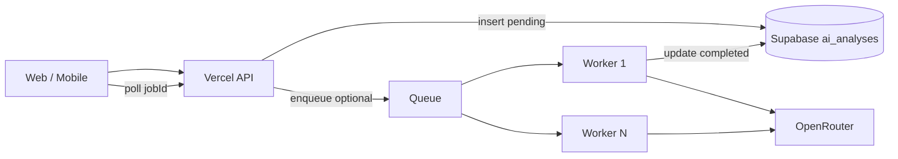

# US AI — масштаб 100–1000 врачей (минимум сейчас, рост потом)

**Персоны:** 👨‍⚕️ PRO-практик (кейсы, DICOM, vision) · 🎓 обучение (atlas, без тяжёлого ML) · 📝 экзамены (без PHI в LLM).

**Статус:** Phase 0 — уже в прод-коде. Phase 1–3 — по мере роста, без ломки API.

---

## Phase 0 — сейчас (до ~150 активных PRO)

Уже реализовано:

| Компонент | Где | Зачем |
|-----------|-----|--------|
| Async job | `POST /api/ai/analyze` → **202** + `jobId` | Не держим UI на одном HTTP |
| Статус | `GET /api/ai/analyze/[jobId]` | Polling |
| Хранение | `ai_analyses` (Supabase, RLS) | История + audit |
| PRO gate | `hasProEntitlement()` | 402 без PRO |
| Rate limit | `RL.aiAnalyze` (env-tunable) | Защита от abuse |
| Worker опционально | `US_AI_WORKER_URL` + secret | DICOM + SonoNet |
| Fallback vision | `OPENROUTER_API_KEY` на Vercel | JPEG/PNG без Railway |

**Операции (минимум):**

1. Worker: **1–2 replica** на PaaS (Railway / Fly / Render) — один `Dockerfile`.
2. Vercel: `US_AI_WORKER_*`, `OPENROUTER_*`, redeploy после ротации секретов.
3. OpenRouter: **лимит $** на ключ + мониторинг Activity.
4. Настройка лимитов: `RATE_LIMIT_AI_ANALYZE`, `RATE_LIMIT_AI_ANALYZE_POLL` (см. `.env.example`).

**Узкое место Phase 0:** выполнение job идёт в **`after()` на Vercel** (`apps/web/app/api/ai/analyze/route.ts`). Для пилота достаточно; при росте пиков — Phase 2.

---

## Phase 1 — ~150–300 врачей

| Действие | Детали |
|----------|--------|
| Worker **≥2 replica** | Healthcheck `/health`, один URL за load balancer PaaS |
| Vercel | Pro plan, следить за concurrent `after()` и `maxDuration` (300s) |
| Алерты | Sentry + weekly OpenRouter spend |
| Rate limits | Ужесточить per-user; позже — per-org (клиника) |
| 152-ФЗ | Политика, где ПДн; **не слать PHI в LLM** сверх контекста кейса |

Документы: [DEPLOYMENT.md](../../services/us-ai-worker/docs/DEPLOYMENT.md), [fly.toml.example](../../services/us-ai-worker/fly.toml.example).

---

## Phase 2 — ~300–1000 врачей (главный архитектурный шаг)

**Цель:** вынести **исполнение** analyze с Vercel на **worker pool + очередь**.

**Контракт не меняется:** `POST /api/ai/analyze` → 202, poll `[jobId]`.

**Реализация (инкремент):**

1. Env `AI_ANALYZE_EXECUTOR=vercel_after` (default) | `worker_queue` (future).
2. При `worker_queue`: Vercel только создаёт `ai_analyses` + триггер (webhook / Supabase Realtime / pg_notify / Vercel Queue).
3. Worker: `POST /internal/process-job` или pull `pending` с `FOR UPDATE SKIP LOCKED`.
4. Поля в БД (миграция когда включим Phase 2): `attempts`, `locked_at`, `priority`, `org_id` (nullable).

**Почему не сейчас:** Phase 0 + 2 replica worker закрывают пилот и ранний рост; очередь — когда метрики покажут saturation Vercel `after()`.

---

## Phase 3 — 500–1000+, B2B клиники

| Тема | Решение |
|------|---------|
| Лимиты | Quota PRO на **organization**, не только user |
| LLM | Vercel AI Gateway / BYOK, fallback model |
| GPU (SonoNet, USTri) | Отдельный autoscale pool, не на каждый HTTP |
| Регион | RU/EU worker по договору с ЛПУ |
| Mobile | Тяжёлый AI только cloud; offline — калькуляторы, курсы |

---

## «Своё» vs облако

| Слой | Стратегия |
|------|-----------|
| Продукт | Протоколы, O-RADS/IOTA, Evidence, UX, дисклеймеры — **ваше** |
| Vision LLM | OpenRouter / gateway до доказанного объёма |
| Собственные веса | Отдельный R&D, не блокер Phase 0–2 |

---

## Чеклист решений (когда переходить фазу)

| Сигнал | Действие |
|--------|----------|
| P95 analyze > 2 min, частые failed timeout | Phase 2 queue |
| >30 одновременных processing в `ai_analyses` | +worker replica, затем Phase 2 |
| OpenRouter > budget | Cap + ужесточить rate limit |
| ЛПУ требует РФ-only | Phase 3 region + legal |

---

## Связанные файлы

- `apps/web/app/api/ai/analyze/route.ts` — job + `after()`
- `apps/web/lib/ai/us-vision/run-case-analysis.ts` — worker → OpenRouter
- `packages/database/.../20260208100000_saas_platform_core.sql` — `ai_analyses`
- `apps/web/lib/security/rate-limit-config.ts` — `aiAnalyze`

Обновлено: 2026-10-22.
