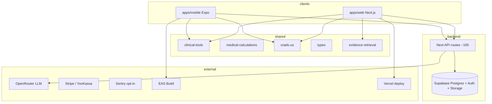

# Repository Map — Monorepo, Apps, Packages, Integrations

**Дата:** 2026-10-17  
**Workspace:** `pnpm-workspace.yaml` → `apps/*`, `packages/*`, `modules/*`

---

## 1. Приложения (`apps/`)

| App | Package name | Назначение | Evidence |
|-----|--------------|------------|----------|
| `apps/web` | `@repo/web` | Next.js 16 PWA, Supabase, основная клиническая платформа | `apps/web/package.json` |
| `apps/mobile` | `@repo/mobile` | Expo RN, 5-tab clinical shell | `apps/mobile/package.json`, `MainTabs.tsx` |
| `apps/fetal-spine-cards` | (отдельный package.json) | Контент/карточки позвоночника плода | `apps/fetal-spine-cards/package.json` |
| `apps/video` | — | **Не зарегистрирован** в workspace; только артефакт `apps/video/out/*.mp4` | glob: нет `apps/video/package.json` |
| `apps/mobile/yakrav7700/` | — | Вложенный scaffold; **ломает** `@repo/mobile` typecheck | ошибки `@/hooks/use-theme` при `pnpm --filter @repo/mobile typecheck` |
| `apps/mobile/server/` | — | Legacy chat API (отдельный сервер) | упомянут в prior explore |

**Статус video/Remotion:** scripts `dev:video`, `render:video` в корневом `package.json` ссылаются на `@repo/video` — **MISSING** в текущем дереве файлов (NOT_APPLICABLE или BLOCKED до восстановления пакета).

---

## 2. Shared packages (`packages/` — 37 package.json)

### Клиника и расчёты

| Package | Роль |
|---------|------|
| `@repo/medical-calculations` | Общие мед. расчёты |
| `@repo/orads-us` | O-RADS US + education + tests |
| `@repo/birads-us`, `@repo/birads-mmg` | BI-RADS US / MMG |
| `@repo/breast-classification` | Дублирующий слой классификации МЖ |
| `@repo/tirads-acr`, `@repo/thyroid-tirads` | TI-RADS (дубли) |
| `@repo/fmf` | FMF / скрининг |
| `@repo/obstetric-engine` | Акушерские расчёты |
| `@repo/examination-engine` | Осмотры |
| `@repo/cervical-pathology-intelligence`, `@repo/cervix-pathology-reference` | CPI / шейка |
| `@repo/musa-framework` | Аденомиоз (MUSA) |
| `@repo/adnex-education` | IOTA/O-RADS snippets для AI RAG-lite |
| `@repo/clinical-tools` | **Каталог модулей + primary nav SSOT** |
| `@repo/clinical-guidelines`, `@repo/nosology`, `@repo/medical-knowledge` | Справочники / нозологии |
| `@repo/obstetric-atlas`, `@repo/clinical-reference` | Атласы и reference |

### Evidence / AI knowledge

| Package | Роль |
|---------|------|
| `@repo/evidence-retrieval` | Unified search (`searchEvidenceUnified`) |
| `@repo/evidence-engine`, `@repo/evidence-corpus` | Движок и корпус |
| `@repo/ai-tutor` | Образование / tutor |

### Platform

| Package | Роль |
|---------|------|
| `@repo/types` | Zod + shared types (cases, discussions) |
| `@repo/database` | Mirror migrations (45 files) |
| `@repo/ui` | Design system |
| `@repo/upload-validation` | Magic bytes (web+mobile) |
| `@repo/report-engine` | PDF / export |

### Web-nested package

- `apps/web/packages/clinical-uterus` — uterus-specific module inside web tree.

---

## 3. Dependency graph (упрощённо)

---

## 4. Маршрутизация web (факты)

- **~199** файлов `page.tsx` под `apps/web/app/` (glob 2026-10-17).
- **~165** `route.ts` под `apps/web/app/api/`.
- Группы: `(clinical)/…`, `(e2e-public)/demo/…`, `login`, `pricing`, `privacy`.
- Primary tabs SSOT: `packages/clinical-tools/src/primary-nav.ts` (`/feed`, `/cases`, `/ai/consultants`, `/tools/calc`, `/profile`).

---

## 5. Mobile navigation (факты)

- Tabs: `FeedTab`, `CasesTab`, `AiTab`, `ToolsTab`, `ProfileTab` — из `CLINICAL_PRIMARY_NAV`.
- Orphan / legacy screens (не в primary tabs): `KnowledgeScreen.tsx`, `CommunityHubScreen.tsx`, `LibraryScreen`, `CalculatorsScreen` (grep/read — не подключены к 5-tab shell или legacy aliases).

---

## 6. Database migrations

| Location | Count | Статус |
|----------|-------|--------|
| `apps/web/supabase/migrations/` | **60** | Канон для web deploy |
| `packages/database/supabase/migrations/` | **45** | Mirror — **drift** |

**Recommendation:** diff имён файлов; один source of truth + CI check.

---

## 7. CI/CD

| Workflow | Trigger | Steps (ключевое) | Последний main |
|----------|---------|------------------|----------------|
| `.github/workflows/ci.yml` | push main, PR | install, **prisma generate**, typecheck, lint, CPI, test:security, upload-validation, **turbo build @repo/web** | **success** |
| same → job `e2e` | after ci | Playwright cpi, auth, a11y, security | part of pipeline |
| `.github/workflows/us-ai-worker.yml` | push | — | **failure 0s** (misconfig / missing secrets?) |

---

## 8. Внешние интеграции (по коду API)

| Integration | API / path hints | Notes |
|-------------|------------------|-------|
| Supabase | `@/utils/supabase/server`, migrations | Auth, RLS, Storage |
| OpenRouter | `lib/ai/sonogyn-chat/openrouter-client.ts` | Chat |
| AI SDK | `lib/ai/sdk/*`, flag `isAiSdkEnabled` | Stream path |
| Stripe | `/api/stripe/*` | Checkout, webhook |
| YooKassa | `/api/yookassa/create` | RU payments |
| Telegram auth/bot | `/api/auth/telegram/*`, `telegram/hermes` | |
| PubMed | `/api/pubmed/abstracts` | External abstracts |
| Cron | `/api/cron/*` | Guidelines ingest, daily summary |
| Sentry | `lib/sentry/*` | PHI scrub |

---

## 9. Дубли и dead weight

| Item | Severity | Evidence |
|------|----------|----------|
| TI-RADS dual packages | P2 | `packages/tirads-acr`, `packages/thyroid-tirads` |
| BI-RADS dual | P2 | `birads-us`, `breast-classification` |
| Migration trees | P0 | counts 60 vs 45 |
| `products/sonogyn-pro` snapshot (if present) | P3 | prior explore |
| Mobile `yakrav7700` nested app | P2 | typecheck errors |

---

## 10. Документация проекта

| Doc | Path |
|-----|------|
| Clinical platform audit (2026-09) | `docs/architecture/clinical-platform-audit.md` |
| RLS audit pointer | `docs/security/rls-audit.md` (referenced) |
| **This audit series** | `docs/audit/00–09*.md` |

---

## 11. Проверки, выполненные при карте

| Command | Result |
|---------|--------|
| `pnpm --filter @repo/web test:security` | **110 pass** |
| `pnpm --filter @repo/orads-us test` | **42 pass** |
| `pnpm --filter @repo/evidence-retrieval test` | **11 pass** |
| `pnpm --filter @repo/web typecheck` (local, no prisma gen) | **fail** PrismaClient |
| `pnpm --filter @repo/mobile typecheck` | **fail** yakrav7700 paths |

CI typecheck на Ubuntu включает `prisma generate` — локальная среда **не эквивалентна** без этого шага.
