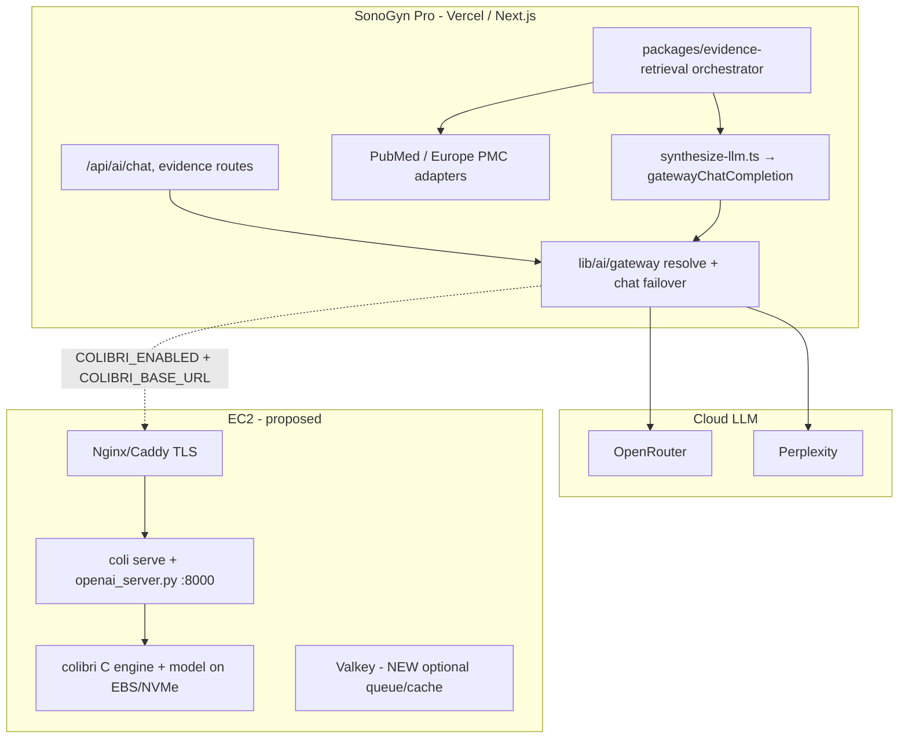

# SonoGyn Pro × Colibri — аудит для self-hosted AWS (EC2)

**Дата:** 2026-11-22  
**Режим:** read-only (файлы `~/colibri`, monorepo SonoGyn, без AWS/прод-изменений)  
**Аудитор:** Cursor agent (Principal Architect pipeline, STEP 1–3)  
**Локальная проверка:** `pnpm colibri:status` → модель `qwen36-35b` частично, `coli setup` unfinished, `:8000` down  

---

## Executive summary

| Вопрос | Ответ |
|--------|--------|
| Нужен ли Colibri для SonoGyn сегодня? | **Опционально** — Evidence/PubMed работают без Colibri; LLM — через OpenRouter/Perplexity |
| Целевой `t4g.large` (8 GB) + default `qwen36-35b`? | **Нет** — каталог Colibri: `ram_min_gb=10`, `ram_good_gb=20` |
| ARM64 (Graviton) | **Совместим при сборке из исходников**; **prebuilt для Linux aarch64 нет** |
| Есть ли «Colibri Worker» / Redis в upstream? | **Нет** — один процесс `coli serve` (Python gateway + C engine) |
| Verdict | **READY WITH MODIFICATIONS** |

---

## 1. Фактическая архитектура Colibri (сейчас)

### 1.1 Структура репозитория (`~/colibri`)

| Путь | Назначение |
|------|------------|
| `c/coli` | CLI: setup, start, stop, serve, chat, doctor, plan, import (GGUF) |
| `c/colibri` (+ family binaries) | C inference engines (MoE streaming с диска) |
| `c/openai_server.py` | **Gateway**: OpenAI-compatible API (`/v1/chat/completions`, `/v1/models`) |
| `c/family_registry.py`, `c/resource_plan.py` | Маршрутизация семейств моделей, планирование RAM |
| `c/setup_catalog.py` | Каталог моделей SonoGyn default `qwen36-35b` |
| `web/` | Dashboard (Vite/React) — порт **8000** после `coli start` |
| `ui/server.py`, `ui/agents.py` | UI proxy, launch coding agents (Claude/Codex/OpenCode → Colibri) |
| `docker/Dockerfile.slim` | Multi-stage CPU image, порт compose **5000** (не 8000) |
| `docker/docker-compose.yml` | Один сервис `colibri`, без Redis |
| `pyproject.toml` | Python ≥3.10, package `colibri-engine`, optional torch for convert |
| `SONOGYN.md` | Указатель на SonoGyn env |

### 1.2 Точки входа и порты

| Интерфейс | URL (локально) | Протокол |
|-----------|----------------|----------|
| OpenAI API | `http://127.0.0.1:8000/v1` | Bearer, chat completions |
| Dashboard | `http://127.0.0.1:8000/` | HTTP |
| Docker slim default | `http://127.0.0.1:5000/v1` | То же |

SonoGyn ожидает **8000** (`COLIBRI_BASE_URL` default в `apps/web/lib/ai/gateway/resolve.ts`).

### 1.3 AI Provider Router (Colibri внутри)

В Colibri **нет** отдельного «AI Provider Router» как в SonoGyn — выбор модели:

- каталог `setup_catalog.py` + `coli setup`;
- семейство → бинарь в `family_registry.py`;
- один активный checkpoint на инстанс `serve`.

Failover между cloud-провайдерами — **только в SonoGyn** (`apps/web/lib/ai/gateway/*`).

### 1.4 Агенты и MCP

| Компонент | Факт |
|-----------|------|
| Coding agents | `ui/agents.py` — Claude, Codex, OpenCode, Pi, OpenClaw, Hermes (локальные терминалы) |
| MCP в Colibri | **Не обнаружен** как production dependency sidecar |
| Health | `coli doctor`, `coli status`, `GET /v1/models` |

### 1.5 Текущее состояние у фаундера (2026-11-22)

```
model     Qwen3.6-35B-A3B  (~/colibri-models/qwen36-35b)
install   unfinished: run `coli setup` to continue
server    stopped
```

Модель на диске **не готова к inference** до завершения `coli setup`.

---

## 2. Схема зависимостей



**Легенда:** сплошная линия — уже в коде; пунктир — опциональная связь при private URL / VPN / Tailscale.

---

## 3. ARM64 compatibility matrix

Цель: **Ubuntu 24.04 aarch64**, AWS Graviton2 (`t4g.*`).

| Компонент | ARM64 | Комментарий |
|-----------|-------|-------------|
| Colibri C engine (`c/Makefile`) | **compatible** | Ветка `aarch64` / `ARM64`, `PORTABLE_ARCH=armv8-a` |
| Prebuilt release tarball | **incompatible** | `release_asset_suffix`: только `linux-x86_64`, `macos-arm64`, `windows-x86_64` — **нет `linux-aarch64`** |
| Docker `Dockerfile.slim` `ARG ARCH=x86-64-v3` | **incompatible as-is** | На Graviton нужен `ARCH=armv8-a` (или `native`) при build |
| Python 3.10+ gateway (`openai_server.py`) | **compatible** | Stdlib only в runtime image |
| Vulkan on Graviton | **unknown** | Часто нет GPU на `t4g`; CPU path |
| CUDA | **N/A** | Нет NVIDIA на t4g |
| Node `web/` dashboard | **compatible** | Есть `@rolldown/binding-linux-arm64-gnu` |
| DeepSeek V4 family on linux/arm | **compatible** | `setup_catalog.platform_supported` |
| SonoGyn Next.js on same EC2 | **compatible** | Не рекомендуется совмещать с inference на 8 GB |

### 3.1 Минимальная адаптация под ARM64 (без переписывания Colibri)

1. Сборка engine на инстансе: `make -C c colibri ARCH=armv8-a` (или `native` на Graviton3).
2. Docker build-arg: `ARCH=armv8-a`, platform `linux/arm64`.
3. Не полагаться на GitHub prebuilt для Linux ARM.

### 3.2 Альтернатива x86_64

| Инстанс | RAM | Плюс | Минус vs t4g |
|---------|-----|------|----------------|
| `t3.large` | 8 GB | Привычный x86, prebuilt linux-x86_64 | Дороже ~15–25%, та же RAM-проблема с qwen36-35b |
| `t3.xlarge` | 16 GB | Влезает qwen36 в tight mode | ~$60–70/mo, выше бюджета риск |

---

## 4. Local inference (GGUF / CPU / 8 GB)

### 4.1 Официальный каталог Colibri (чат)

| Model ID | ram_min | ram_good | disk | На t4g.large 8GB |
|----------|---------|----------|------|------------------|
| `qwen36-35b` (SonoGyn default) | 10 GB | 20 GB | 23 GB | **needs-ram** |
| `qwen3-coder-30b` | 8 GB | 18 GB | — | **tight** (без запаса под OS) |
| `qwen-image-2.1` | 12 GB | — | 33 GB | image only, N/A chat |

**Qwen 3.6 35B на 8 GB — не целевая конфигурация** (подтверждено каталогом).

### 4.2 GGUF Q4 (компактные)

- Поддержка: `coli import` + `coli serve` ([`docs/gguf.md`](file:///Users/yakrav7700/colibri/docs/gguf.md)).
- Архитектуры `qwen3`, `qwen3moe`, `qwen35moe`, `inkling`, dense small — совместимы с gateway.
- **Не скачивали / не бенчмаркали** в этом аудите (ограничение задачи).
- Для **8 GB EC2** разумная гипотеза: dense **≤3B–7B** Q4_K или MoE small с **жёстким expert cache** + swap на **только EBS gp3** (медленно).

### 4.3 Реальное потребление RAM (из документации Colibri)

- MoE: resident = dense + cached experts (`resource_plan.py` / `setup_catalog.py`).
- `qwen36-35b`: peak **~17 GB** при полном кэше экспертов (docs/qwen36.md, цит. в catalog).

### 4.4 Подключение как provider в SonoGyn

Уже есть: `COLIBRI_MODEL=<id из /v1/models>`, `COLIBRI_ENABLED=true`, `COLIBRI_BASE_URL=https://…/v1`.

Timeout local: **15 s** (`provider-failover.ts`) — на CPU MoE с cold expert fetch возможны **ложные failover** на cloud.

---

## 5. Интеграция с SonoGyn Pro

### 5.1 Где что живёт

| Функция | Модуль | Зависит от Colibri? |
|---------|--------|---------------------|
| PubMed / корпуса / ранжирование | `packages/evidence-retrieval` (`orchestrator.ts`, `pubmed.adapter`) | **Нет** |
| Синтез ответа Evidence | `apps/web/lib/evidence/synthesize-llm.ts` → `gatewayChatCompletion` | **Опционально** (cloud fallback) |
| MI Evidence binding | `apps/web/lib/ai/mi/evidence-binding.ts` | Опционально |
| Chat врачей | `apps/web/lib/ai/gateway/chat.ts` | Опционально |
| Evidence Orchestrator | **`packages/evidence-retrieval/src/orchestrator.ts`** (не Colibri) | Нет |
| Colibri sidecar ops | `scripts/colibri/*`, `integrations/colibri/README.md` | — |

### 5.2 Деградация при недоступности AI

- Поиск источников: адаптеры отрабатывают независимо.
- Пустой поиск → `insufficient`, claims очищаются (`claims.ts`, тесты).
- Нет LLM: `hasAnyLlmConfigured()` → synthesis может упроститься / rules path (см. `synthesize-llm.ts`, `evidence-retrieval`).

**PubMed Engine сохраняется** без Colibri.

### 5.3 PHI / ПДн

- В промпт synthesis идут **обрезанные** citations (title, abstract slice ≤400, quote ≤280) — **не полные карты пациента**.
- Риск: врач вводит ФИО/дату рождения в **свободный запрос** → уходит в LLM (любой provider).
- Рекомендация для AWS Colibri: **только server-to-server**, private network, **не** логировать bodies, guardrail на client query strip (отдельная волна, не prod сейчас).

### 5.4 Контракт API

| Consumer | Endpoint Colibri | SonoGyn env |
|----------|------------------|-------------|
| Gateway | `POST /v1/chat/completions` | `COLIBRI_BASE_URL`, `COLIBRI_API_KEY` |
| Health | `GET /v1/models` | `GET /api/ai/gateway/status` |

Prod Vercel: Colibri **off by default** (`COLIBRI_ENABLED` unset) — **не ломать**.

---

## 6. Рекомендуемая Docker Compose (целевая, **не применять без approval**)

Добавочный слой **рядом** с upstream compose; Redis **для SonoGyn**, не часть Colibri core.

```yaml
# docs/colibri_aws_deployment_audit.md — reference only
services:
  colibri:
    build:
      context: ${COLIBRI_HOME}
      dockerfile: docker/Dockerfile.slim
      args:
        ARCH: armv8-a   # t4g
    ports:
      - "127.0.0.1:8000:8000"
    volumes:
      - /data/colibri-models:/model:ro
    environment:
      COLI_RAM: "6"     # tight 8GB host — подобрать после bench
    command: ["serve", "--host", "0.0.0.0", "--port", "8000", "--model-id", "${COLIBRI_MODEL_ID}"]
    healthcheck:
      test: ["CMD", "curl", "-f", "http://127.0.0.1:8000/v1/models"]
      interval: 30s
      timeout: 10s
      retries: 3
    restart: unless-stopped
    deploy:
      resources:
        limits:
          memory: 7G

  valkey:
    image: valkey/valkey:8-alpine
    command: valkey-server --maxmemory 256mb --maxmemory-policy allkeys-lru
  # Optional: rate limit / evidence cache for SonoGyn worker — not Colibri native

  caddy:
    image: caddy:2-alpine
    ports:
      - "443:443"
    volumes:
      - ./Caddyfile:/etc/caddy/Caddyfile
      - caddy_data:/data
    restart: unless-stopped
```

**Worker:** в Colibri нет. Если нужен async — `services/us-ai-worker` или новый thin worker в monorepo (волна 3), **не** замена `openai_server.py`.

---

## 7. Security checklist (pre-production)

| # | Пункт |
|---|--------|
| 1 | Colibri **не** в public internet без mTLS/VPN; prefer Tailscale/WireGuard + SG |
| 2 | Bearer `COLIBRI_API_KEY` ≠ `colibri-local` в AWS |
| 3 | Security Group: 443 only from clinic IPs / VPN CIDR |
| 4 | EBS encryption, model volume **no** snapshots to shared account |
| 5 | Vercel: **не** ставить `COLIBRI_BASE_URL=127.0.0.1`; remote URL только после private link design |
| 6 | Логи Caddy: без тела chat; retention ≤7d |
| 7 | IMDSv2 required on EC2 |
| 8 | SSH → SSM Session Manager preferred |
| 9 | Автообновления security patches (unattended-upgrades) |
| 10 | Ротация API key при компрометации |

---

## 8. Оценка AWS расходов (us-east-1, on-demand, ориентир)

| Статья | t4g.large | t4g.xlarge (если qwen36) |
|--------|-----------|---------------------------|
| Compute | ~$49/mo | ~$98/mo |
| EBS 80 GB gp3 | ~$6.4/mo | ~$6.4/mo |
| EBS 30 GB model extra | ~$2.4/mo | ~$2.4/mo |
| Data transfer (умеренный) | $5–15/mo | $5–15/mo |
| **Итого** | **~$63–75/mo** | **~$112/mo ⚠️** |

**Вывод по бюджету $100/mo:**

- **t4g.large + малая GGUF/ tight MoE** — **в бюджете**.
- **t4g.large + qwen36-35b** — **не влазит по RAM**.
- **t4g.xlarge + qwen36-35b** — **на грани / выше** бюджета.

Резерв: не включать NAT Gateway ($32+/mo) без нужды; исходящий трафик LLM — минимальный (inference local).

---

## 9. Риски и ограничения

| Риск | Severity | Mitigation |
|------|----------|------------|
| 8 GB RAM vs default model | **Blocker** | Сменить model tier или инстанс |
| 15s Colibri timeout → cloud leak | **High** | Увеличить local timeout purpose=evidence; colibri-first order только на private host |
| Нет linux-arm64 prebuilt | **Med** | Build on first boot (user-data script) |
| Диск MoE latency на gp3 | **Med** | NVMe instance store недоступен на t4g — only EBS; expect slow tok/s |
| Partial setup на Mac | **Low** | Завершить `coli setup` локально для baseline |
| Scope creep (Redis, Worker) | **Med** | Valkey только если нужен async; не блокирует MVP |
| PHI в free-text query | **High** | Product guard + дисклеймер; не отправлять patient id в prompts |

---

## 10. Пошаговый deployment plan (после approval, **волны**)

### Wave 0 — Decision (без AWS)

- [ ] Выбрать model class: **A)** small GGUF on t4g.large **B)** qwen36 on t4g.xlarge **C)** только cloud, Colibri отложить
- [ ] Завершить `pnpm colibri:setup` на Mac для эталона
- [ ] Зафиксировать `COLIBRI_MODEL` id и latency p95

### Wave 1 — Staging EC2 (manual approval)

- [ ] Ubuntu 24.04 arm64, t4g.large, encrypted gp3
- [ ] Build Colibri from `~/colibri` clone, `coli import` или `setup` выбранной модели
- [ ] `coli serve` на :8000, healthcheck
- [ ] **Не** трогать Vercel prod

### Wave 2 — Edge + access

- [ ] Caddy + Let's Encrypt **или** Tailscale only
- [ ] SG hardening, API key
- [ ] `pnpm colibri:check` с doctor-box `.env.local` → remote URL (staging)

### Wave 3 — SonoGyn wiring (staging preview only)

- [ ] Preview env: `COLIBRI_ENABLED`, `COLIBRI_BASE_URL`, `LLM_FALLBACK_ORDER=colibri,openrouter,…`
- [ ] Evidence e2e: PubMed without LLM + with Colibri
- [ ] Load test 10 concurrent (ожидать throttle)

### Wave 4 — Production promotion

- [ ] Runbook `docs/operations/AI_FAILOVER_RUNBOOK.md`
- [ ] Мониторинг: synthetic `GET /v1/models` + gateway status
- [ ] Rollback tag на AMI / compose revision

---

## 11. Rollback plan

| Шаг | Действие |
|-----|----------|
| 1 | Vercel: `COLIBRI_ENABLED=false` или удалить remote URL (мгновенно → cloud) |
| 2 | Stop compose: `docker compose down` на EC2 |
| 3 | Terminate EC2 or keep stopped (compute $0, EBS $) |
| 4 | DNS/Tailscale: убрать route |
| 5 | При corrupt model: restore EBS snapshot **или** re-`coli setup` |

**RTO:** &lt;15 min (env flip на Vercel). **RPO:** stateless inference — N/A.

---

## 12. Тесты до production

| # | Тест | Команда / путь |
|---|------|----------------|
| 1 | Colibri health | `curl -s $BASE/v1/models` |
| 2 | SonoGyn check | `pnpm colibri:check` |
| 3 | Gateway unit | `pnpm --filter @repo/web test` resolve/failover tests |
| 4 | Evidence structural | `packages/evidence-retrieval` claims tests |
| 5 | E2E Evidence soft | `pnpm --filter @repo/web test:e2e` (subset evidence) |
| 6 | A11y login/evidence | unchanged |
| 7 | PHI smoke | запрос без ПДн; логи EC2 — нет body |
| 8 | Failover | stop Colibri → Evidence still returns citations |
| 9 | ARM rebuild | `coli doctor` after reboot |
| 10 | Cost alarm | AWS Budget $100 alert |

---

## 13. Обязательные изменения (минимальный diff, будущие волны)

| # | Изменение | Где | Обязательность |
|---|-----------|-----|----------------|
| 1 | `Dockerfile.slim` multi-arch build args doc/script | `~/colibri/docker` или fork patch | Для ARM EC2 |
| 2 | Compose port 8000 align with SonoGyn | deploy repo / `docs/operations` | Да |
| 3 | Model policy: не `qwen36-35b` on 8GB | SonoGyn env docs + `COLIBRI_SETUP_MODEL` | Да |
| 4 | Remote Colibri URL + API key staging | Vercel **preview only** | При cloud→EC2 |
| 5 | Optional: evidence local timeout env | `provider-failover.ts` | Рекомендуется |
| 6 | Valkey | только если queue needed | Опционально |

**Не требуется:** переписывать agents, MCP в Colibri, менять Evidence orchestrator placement.

---

## 14. Что реально поможет SonoGyn (приоритет)

| Приоритет | Действие | Зачем |
|-----------|----------|-------|
| P0 | Держать prod **cloud-first** | Уже работает на Vercel |
| P0 | Evidence / PubMed без Colibri | Уже в `evidence-retrieval` |
| P1 | Doctor-box: закончить **local** `coli setup` | Проверить гипотезы до AWS $ |
| P1 | Выбор **малой** модели под 8 GB **или** t4g.xlarge | Иначе EC2 бессмысленен |
| P2 | Private EC2 + Tailscale | Безопасный доступ без публичного LLM |
| P3 | AWS после bench на Mac/Linux | Этот аудит |

**Mail.ru / почта / прочее** — вне scope.

---

## 15. Связанные документы SonoGyn

- `integrations/colibri/README.md`
- `docs/integrations/colibri.md`
- `docs/architecture/AI_PROVIDER_ARCHITECTURE.md`
- `docs/audit/COLIBRI_CLOUDFLARE_COMPATIBILITY.md`
- `apps/web/.env.example` (LLM_* / COLIBRI_*)

---

## Вердикт

### **READY WITH MODIFICATIONS**

- **Не** `READY FOR AWS t4g.large` с текущим default `qwen36-35b`.
- **Не** `NOT READY` — engine, gateway, SonoGyn integration **уже существуют**; нужны **правильный instance/RAM**, **ARM build from source**, **model downgrade или upscale**, **private networking**, **staging env**.

**Условия перехода в `READY FOR AWS t4g.large`:**

1. Выбрана и замеренная модель с `ram_min_gb ≤ 7` (с запасом под OS) **или** подтверждён tight run `qwen3-coder-30b` на 8 GB.
2. Успешный `coli serve` на arm64 после source build.
3. p95 chat &lt; 15 s или увеличен local timeout для evidence.

---

## Следующий шаг (STEP 4 — ждём «ок»)

Предлагаемые **волны реализации** (только после твоего одобрения):

1. **Волна A** — локально: доделать `coli setup`, bench модели, записать latency в этот doc (appendix).
2. **Волна B** — черновик `deploy/colibri-aws/` (compose + Caddy + user-data), **без** apply.
3. **Волна C** — staging EC2 по твоему явному «создавай инстанс».
4. **Волна D** — Vercel preview env + тесты из §12.

Напиши **«ок, волна A»** (или укажи модель/инстанс: **t4g.large + small GGUF** vs **t4g.xlarge + qwen36**).